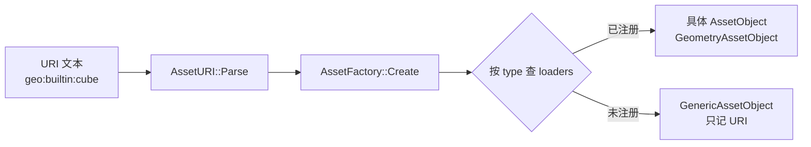

# 类型化资产 URI 与资产工厂

> 面向两类读者：想在示例/引擎里「用 URI 拿资产」的调用方，以及想「新增一种资产类型」的实现者。
> 相关代码：`inc/hgl/asset/AssetURI.h`、`inc/hgl/asset/AssetFactory.h`、
> `inc/hgl/graph/asset/GeometryAssetObject.h`、`inc/hgl/graph/asset/GeometryAssetRegistry.h`。

---

## 1. 为什么要有这一层

改造前，每种资产各有自己的入口与注册表：纹理走 `TextureURI`（`file:` / `rt:`），
几何走 `GeometryPresetLibrary::Create(pc,"cube")`，材质配方走 `LoadRecipeFile()`。
调用方拿到一串字符串时，必须自己判断「这是哪种资产」再挑对应的表——每加一种资产，
所有调用点都要改一遍，示例代码里也就出现了大量硬编码的 `CreateGeometryPreset(pc,"xxx")`。

改造后统一成一条链路：



三个关键决策：

1. **类型写进 URI**，与 UE 的 `/Game/Path/Asset.Asset` 同类思路：定位串自带类型信息，
   调用方不必预先声明「我要读的是几何还是纹理」。
2. **加载器自注册**，每种资产的实现 `.cpp` 自己往 `AssetFactory` 里登记，
   工厂与已有调用方一行都不用改。
3. **未注册类型降级而不失败**：拿不到具体对象也给出一个只带 URI 的
   `GenericAssetObject`，让离线工具（打包、依赖扫描、文档导出）不必认识每种资产。

---

## 2. URI 语法

```
<type> : <source> : <target>      // 完整形式
<type> :            <target>      // 省略来源，由消费方按类型推导
        : <source> : <target>      // 省略类型，由调用方的 default_type 补齐
                    <target>      // 裸定位串
```

**只解析前两个冒号**：类型段与来源段都是不含冒号的短标识符，第三段（`target`）整段保留。
因此 `geo:file:C:\a\b.geo.toml` 与 `tex:rt:A:B:color0` 都不需要额外特判。

### 2.1 类型段（`AssetType`）

| 文本 | 枚举 | 说明 |
|---|---|---|
| `geo` | `AssetType::Geometry` | 几何资产 |
| `tex` | `AssetType::Texture` | 纹理资产（内部仍由 `TextureURI` 解析） |
| `rcp` | `AssetType::MaterialRecipe` | 材质配方 |
| `prim` | `AssetType::Primitive` | 图元资产 |
| `scene` | `AssetType::Scene` | 场景资产 |
| `mtldata` | `AssetType::MaterialData` | 材质数据块（批量 SSBO 行数据，见 `material-instance-and-data-block.md`） |

拼写的**唯一真源**是 `AssetTypeTable[]`：名字、解析、反查三个方向全部从那张表派生，
不得再写第二份拼写。

### 2.2 来源段（`AssetSourceKind`）

| 文本 | 枚举 | 语义 |
|---|---|---|
| `builtin` | `AssetSourceKind::Builtin` | 引擎内建参数化数据，不读盘 |
| `file` | `AssetSourceKind::File` | 磁盘文件 |
| `rt` | `AssetSourceKind::RenderTarget` | 渲染目标附件（仅纹理） |

来源段的语义是「这份资产的数据从哪来」，**不是**「怎么读」：`file` 只说明存在磁盘文件，
具体是 TOML / FlatBuffers / 二进制由各类型自己的注册器决定。

### 2.3 常用写法

```
geo:builtin:cube                     内建几何预设
geo:file:res/geo/unit_cube.geo.toml  几何规约文件（或 .geo minipack）
geo:@cube  /  geo:cube               省略来源（历史写法 geo:@<name> 原样兼容）
tex:file:res/image/brick.tex         纹理文件
tex:rt:Offscreen:color0              渲染目标附件
rcp:@Lit                             材质配方（子配方用 parent = "rcp:@Lit" 继承）
mtldata:file:ShaderLibrary/asset/material_data/pbr_10x10_grid.material_data.toml
mtldata:@pbr_10x10_grid              材质数据块（批量 SSBO 行数据）
texarray:@pbr_10x10_baseColor        纹理数组（层清单在 ShaderLibrary/asset/texarray/，见 2.6）
foo:file:bar.dat                     未注册类型（type 保持 Unknown，type_name 保留原拼写）
```

### 2.4 与老纹理 URI 的关系

`file:<path>` / `rt:<target>[:<attachment>]` 天然落在「省略类型」这一支：
首段 `file` / `rt` 不是资产类型而是来源，于是被识别成来源段，类型留给调用方的
`default_type`（纹理侧传 `AssetType::Texture`）。**老的纹理 URI 文本无需改写。**
`hgl::graph` 侧另有 `ToAssetURI` / `FromAssetURI` 做 `TextureURI` 往返。

### 2.5 API

```cpp
#include <hgl/asset/AssetURI.h>

using namespace hgl::asset;

AssetURI uri = AssetURI::Parse("geo:builtin:cube");          // 显式类型
AssetURI tex = AssetURI::Parse("file:rock.tex", AssetType::Texture);   // 补默认类型

uri.type;        // AssetType::Geometry
uri.source;      // AssetSourceKind::Builtin
uri.target;      // OSString "cube"
uri.raw;         // 原始输入
uri.HasType();   // true
uri.IsBuiltin(); // true
uri.IsFile();    // false

// 拼回文本（省略的段不会被补上，写什么回什么）
OSString s = AssetURI::MakeAssetURI(AssetType::Geometry, AssetSourceKind::Builtin, "cube");
OSString n = AssetURI::Normalize("geo:builtin:cube");   // Parse + ToString
```

> 判定方法只有 `IsValid()` / `HasType()` / `HasSource()` / `IsBuiltin()` / `IsFile()`。
> **没有** `IsRenderTarget()` —— 判 RT 直接比较 `uri.source == AssetSourceKind::RenderTarget`。

### 2.6 纹理数组：`texarray:`

纹理数组是**纹理的子方案**（`TextureURIKind::TextureArray`），不是新的 `AssetType`：
它仍然是一个 `TextureAsset` 句柄，仍然进 `CreateTextureAsset` 的统一分派。

```
texarray:@pbr_10x10_baseColor                        ShaderLibrary/asset/texarray/<name>.texarray.toml
texarray:file:ShaderLibrary/asset/texarray/x.texarray.toml
```

规约文件（`ShaderLibrary/asset/texarray/*.texarray.toml`）只描述**层清单**：

```toml
schema = 1
name = "alpha_checker_baseColor"
mipmaps = 1                              # 可选覆盖；0/缺省 = 跟随第 0 层文件的 mip 数

[[layers]]
uri = "file:res/image/pbr/AlphaChecker/baseColor.Tex2D"
```

约定：

- **规约故意不写 width / height / format** —— 从第 0 层文件探针读出，只允许覆盖 `mipmaps`。
- 层名缺省取「父目录名/文件名主干」（`Concrete_Plain/baseColor`）；只取主干会让 10 层同名撞车。
- 层 URI 写 `file:` 前缀，装配前由 `TextureManager` 剥成裸路径再读盘。
- 不支持 `rt:` 层，不支持嵌套数组；层数上限 `kTextureArrayMaxLayers = 64`。
- 数组装配是**同步**的：`CreateTextureAsset("texarray:...")` 返回时 `GetTexture()` 即可绑定。
  与文件纹理不同（文件句柄创建后是 `MetaOnly`，走 `TextureStreamingSystem` 异步；
  需要立刻可用的场合显式调用 `TextureAsset::LoadPayload()`）。

---

## 3. 资产工厂

```cpp
#include <hgl/asset/AssetFactory.h>

using namespace hgl::asset;

AssetLoadOptions opt;
opt.default_type   = AssetType::Texture;   // URI 省略类型段时补上
opt.allow_fallback = true;                 // 允许降级为 GenericAssetObject

AssetLoadStatus status;
AssetObjectPtr obj = AssetFactory::Instance().Create(u8"tex:file:rock.tex", opt, &status);

if (status == AssetLoadStatus::Fallback)
{
    auto *generic = static_cast<GenericAssetObject *>(obj.get());
    // 只知道「引用了 tex:file:rock.tex」，没有具体规约
}
```

### 3.1 结果码

| 状态 | 含义 |
|---|---|
| `Ok` | 由已注册的加载器成功创建 |
| `Fallback` | 类型未注册（或调用方禁止加载），降级为 `GenericAssetObject`。**不是错误** |
| `ParseFailed` | 加载器接手但读取/校验失败 |

### 3.2 批量读取

```cpp
const OSString uris[] = { u8"geo:builtin:cube", u8"tex:file:rock.tex" };

AssetObjectPtr objects[2];
uint32_t ok = AssetFactory::Instance().Create(uris, 2, objects);

// 输入顺序即输出顺序；单个失败不中断其它项（失败位留空指针）
// 每次都整体覆写（不清空、不追加），调用方无需预置内容
```

### 3.3 注册表管理

```cpp
AssetFactory &factory = AssetFactory::Instance();

factory.Register(AssetType::Scene, &LoadSceneAsset);
factory.IsRegistered(AssetType::Scene);   // true
factory.GetRegisteredCount();
factory.Unregister(AssetType::Scene);
factory.Clear();                          // 主要给测试用
```

> `Unregister()` 只要类型合法就返回 `true`（不管原来有没有加载器）。
> 只有 `Register()` 会因 `fn == nullptr` 或类型越界返回 `false`。

### 3.4 线程约定

注册表**不是**线程安全的。注册只在启动期（静态初始化或首次使用前）发生，之后只读。
加载器本身可能触及 GPU 资源，同样应在主线程调用。

---

## 4. 未注册类型的降级

`GenericAssetObject` 是刻意设计的产物：

- 离线工具（打包、依赖扫描、文档导出）只需要知道「这个场景引用了什么」，
  不需要真的把每个资产读进内存——能拿到 URI 就够了；
- 老版本引擎/工具遇到新类型资产时，不应整体崩掉；
- 与 `AssetURI` 对未注册类型段「保留原拼写」的语义自然衔接。

```cpp
class GenericAssetObject : public AssetObject
{
    AssetURI   uri;          // 解析结果（type 可能是 Unknown，type_name 保留原拼写）
    AnsiString asset_name;

    const ClassMetaInfo *GetClassMetaInfo() const override { return nullptr; }  // 无具体规约
    const AssetURI      &GetURI()           const { return uri; }
    bool                 IsFallback()       const { return true; }
};
```

`GetClassMetaInfo()` 恒为 `nullptr` 是「没有具体规约」的**显式信号**：
通用检查器遇到它应退化成「只显示 URI」。

---

## 5. 几何资产：URI 门面的完整链路

几何是第一个走通全链路的类型，可作为新增类型的模板。

### 5.1 三层结构

```
AssetURI("geo:builtin:cube")
   ↓ AssetFactory（AssetType::Geometry → LoadGeometryAsset）
GeometryAssetObject（不拥有句柄的 AssetObject 外壳）
   ↓ 指向
GeometryAsset*（注册器持有；持 Geometry* 与流送状态）
```

`GeometryAsset` 是 GPU 侧句柄，不是值语义规约，因此它**不继承** `AssetObject`；
`GeometryAssetObject` 只是薄适配层。外壳析构**不会**释放 GPU 资源，
句柄生命周期由 `GeometryAssetRegistry::Clear()` 决定。

### 5.2 加载器注册时机

几何加载需要设备与注册器，所以在 `GraphicsContext::Initialize()` 之后调用
`RegisterGeometryAssetLoader(registry)`。在那之前 `AssetFactory` 对
`AssetType::Geometry` 没有加载器 ⇒ 走 `GenericAssetObject` 降级路径，
这正好是离线工具想要的「不建 GPU 资源也能读元数据」。

### 5.3 示例层门面（最常用）

`WorkObject` 派生类里直接用：

```cpp
// 默认顶点布局（Position VF_V3F / TexCoord VF_V2HF / Normal VF_V2UN8）
Geometry *cube = GetGeometry("geo:builtin:cube");

// 需要别的语义（顶点色、gizmo 布局、仅 Position 的天空球……）⇒ 传 format_override
const GeometryVertexFormat sky_format = CreateSkyGeometryVertexFormat();
Geometry *sky = GetGeometry("geo:builtin:hex_sphere_sky", &sky_format);

// 需要规约（name / AABB / 流送状态）时用资产入口
const GeometryAsset *asset = GetGeometryAsset("geo:file:res/geo/x.geo.toml");
```

`GetGeometry()` / `GetGeometryAsset()` 返回的对象由 `GraphicsContext` 里的
`GeometryAssetRegistry` 持有：**不要**自己 `delete`，**也不要**再交给
`GeometryManager::Add()`（那是另一条所有权线，会双销毁）。

### 5.4 共享顶点池：`SharedCreaterScope`

注册器默认给每个几何建一套私有 VDM/缓冲。若一批几何应该共享同一个
`VertexDataManager`（一支大缓冲、段偏移寻址），就把创建器临时绑到注册器上：

```cpp
GeometryCreater pc(mesh_vdm);                                  // 栈上，不是 new
SharedCreaterScope scope(GetGeometryAssetRegistry(), &pc);     // 析构自动还原

Geometry *a = GetGeometry("geo:builtin:sphere_64");            // 写进 mesh_vdm
Geometry *b = GetGeometry("geo:builtin:cube");                 // 同一个 mesh_vdm
```

要点：

- 作用域必须**包住**所有 URI 几何的创建；中途 `return false` 时自动还原，安全。
- 共享模式下顶点布局由创建器决定，**忽略** `format_override`。
- 生命周期顺序：先 `registry->Clear()`（销毁几何），再销毁 `mesh_vdm`
  （几何的 `GeometryDataVDM` 会把段还给 VDM）。
- 注册器**不拥有**创建器，`SetSharedCreater(nullptr)` 只解绑、不回收已建的几何。

### 5.5 三条创建路径的对应关系

| 场景 | 写法 |
|---|---|
| 每几何一套私有缓冲（默认） | `GetGeometry(uri)` |
| 每几何一套私有缓冲 + 指定布局 | `GetGeometry(uri, &format)` |
| 一批几何共享一个 VDM | `GeometryCreater pc(vdm); SharedCreaterScope scope(...); GetGeometry(uri)` |

底层实现（引擎内部，示例不应直接调）：

```cpp
Geometry *CreateGeometryFromSpec(VulkanDevice*, BufferManager*, const GeometryAssetSpec&,
                                 const GeometryVertexFormat *gvf_override);
Geometry *CreateGeometryFromSpec(GeometryCreater*, const GeometryAssetSpec&);
```

### 5.6 内建几何的来源

`geo:builtin:<name>` 的 `<name>` 就是 `res/geo/presets/<name>.geo.toml` 的文件名主干。
新增内建形状 = 加一个 `.geo.toml`，不改 C++。当前共有 33 个预设，
全量可解析性由 `TestGeometryPreset` 守住。

`Arrow` / `PipeElbow` 这类**带运行时参数**的形状尚未进入 `*.geo.toml` schema，
相关示例代码仍是 `#if 0`；运行时 `WriteVAB()` 写顶点数据的路径（射线线段、
动态网格）也保留直接 API。

---

## 6. 新增一种资产类型的清单

以「假设要加 `AssetType::Skeleton`」为例：

1. **枚举 + 拼写表**（`inc/hgl/asset/AssetURI.h`）
   ```cpp
   enum class AssetType : uint8
   {
       ...
       Skeleton,          ///<`skel` —— 骨骼资产
       ENUM_CLASS_RANGE(Geometry, Skeleton)     // 扩展上界
   };

   inline constexpr AssetTypeDesc AssetTypeTable[] =
   {
       ...
       { AssetType::Skeleton, "skel", "skeleton" },
   };
   ```
   `RANGE_SIZE` 会自动跟着 `ENUM_CLASS_RANGE` 上界变，`AssetFactory::loaders[]` 无需手改。

2. **资产对象外壳**（新建文件，如 `inc/hgl/graph/asset/` 下放一个 `SkeletonAssetObject.h`）
   继承 `asset::AssetObject`，`GetClassMetaInfo()` 返回生成物里的 `Class_SkeletonSpec`
   （由 `HGL_ASSET_STRUCT` 自动生成，见 `doc/assetgen-rebuild-guide.md`）。

3. **加载器 + 自注册**（新文件 `.cpp`）
   ```cpp
   namespace
   {
       SkeletonRegistry *g_skeleton_registry = nullptr;

       bool LoadSkeletonAsset(const asset::AssetURI &uri,
                              asset::AssetObjectPtr &out,
                              AnsiString &error)
       {
           if (!g_skeleton_registry) { error = "skeleton loader: registry not bound"; return false; }

           SkeletonAsset *asset = g_skeleton_registry->GetOrLoadURI(uri.raw);
           if (!asset) { error = "skeleton loader: resolve failed"; return false; }

           out = asset::AssetObjectPtr(new SkeletonAssetObject(asset, uri));
           return true;
       }
   }

   bool RegisterSkeletonAssetLoader(SkeletonRegistry *registry)
   {
       g_skeleton_registry = registry;
       return asset::AssetFactory::Instance().Register(asset::AssetType::Skeleton,
                                                       &LoadSkeletonAsset);
   }
   ```

4. **在图形初始化后注册**（与 `RegisterGeometryAssetLoader()` 同一处）。

5. **测试**：加一个 `TestAssetSkeleton`，覆盖「URI 解析 → 工厂分派 → 就绪判定 →
   降级路径」。`TestAssetURI` / `TestAssetFactory` 已有的用例可作为模板。

6. **文档**：本文件第 2.1 节的类型表补一行。

> 未注册时的行为**已经正确**：`Parse()` 把未知类型段的原拼写留在 `type_name`，
> `AssetFactory::Create()` 返回 `GenericAssetObject`。所以第 2~4 步可以分阶段做，
> 中间态不会让调用方崩。

---

## 7. 示例改造对照

改造前后示例的典型形态：

```cpp
// 改造前：创建器用法泄露到示例，几何归 GeometryManager 持有
auto pc = std::make_unique<GeometryCreater>(mesh_vdm);
Geometry *cube = CreateGeometryPreset(pc.get(), "cube");
geometry_manager->Add(cube);

// 改造后：示例只认 URI，几何归 GeometryAssetRegistry 持有
GeometryCreater pc(mesh_vdm);
SharedCreaterScope scope(GetGeometryAssetRegistry(), &pc);
Geometry *cube = GetGeometry("geo:builtin:cube");
```

批量场景直接表驱动：

```cpp
static const char *geometry_uri[] =
{
    "geo:builtin:plane_square",
    "geo:builtin:sphere_64",
    "geo:builtin:dome_64",
    // ...
};

GeometryCreater pc(mesh_vdm);
SharedCreaterScope scope(GetGeometryAssetRegistry(), &pc);

for (int i = 0; i < int(sizeof(geometry_uri) / sizeof(geometry_uri[0])); ++i)
{
    Geometry *geom = GetGeometry(geometry_uri[i]);
    if (!geom)
        return false;

    if (!CreateMeshEntry(geom, i))
        return false;
}
```

析构处统一改为：

```cpp
// 先销毁几何，再销毁顶点池 / 设备
mesh_entries.clear();            // 只清观察指针
if (auto *registry = GetGeometryAssetRegistry())
    registry->Clear();

SAFE_CLEAR(mesh_vdm)
```

---

## 8. 门禁与回归

```powershell
# 规约结构一致性（改了 HGL_ASSET_STRUCT 注释/字段必须重跑 -Write）
pwsh -NoProfile -File scripts\run-assetgen.ps1 -Check -Clang "C:\clang\bin\clang++.exe"

# 单元测试（均在仓库根 E:\ULRE 运行，依赖相对路径）
build\out\Windows_64_Release\TestAssetURI.exe          # 89 项
build\out\Windows_64_Release\TestAssetFactory.exe      # 62 项
build\out\Windows_64_Release\TestGeometryPreset.exe    # 33 个预设全量解析
build\out\Windows_64_Release\TestSceneFile.exe
build\out\Windows_64_Release\TestAssetReflection.exe   # FlatBuffers 往返
```

示例冒烟：任意示例跑 8~10 秒，正常输出应出现

```
[T5] GPU cull instanced draw ENGAGED: 世界=... batches=N/N buckets=M items=K
```

`shader-cache\stage\*.spv 的 open file error` 是首次编译前的正常探测；
`[MaterialRecipeRegistry] ... errors=0` / `[GlslModuleRegistry] ... 0 errors`
是含 `ERROR` 字样但正常的行，需人工甄别。

---

## 9. 延伸阅读

| 主题 | 文档 |
|---|---|
| 材质配方继承（`parent`）、批量材质数据块（`mtldata`）、`WithMaterialDataRow` | `doc/material-instance-and-data-block.md` |
| 加了 `HGL_ASSET_STRUCT` 之后要重跑什么 | `doc/assetgen-rebuild-guide.md` |
| 上层统一序列化（Presence / Archive / 三后端） | `doc/unified-serialization-2026-10-30.md` |
| 表面领域契约与 Recipe 文件契约 | `doc/material-domain-contract-architecture.md` |
