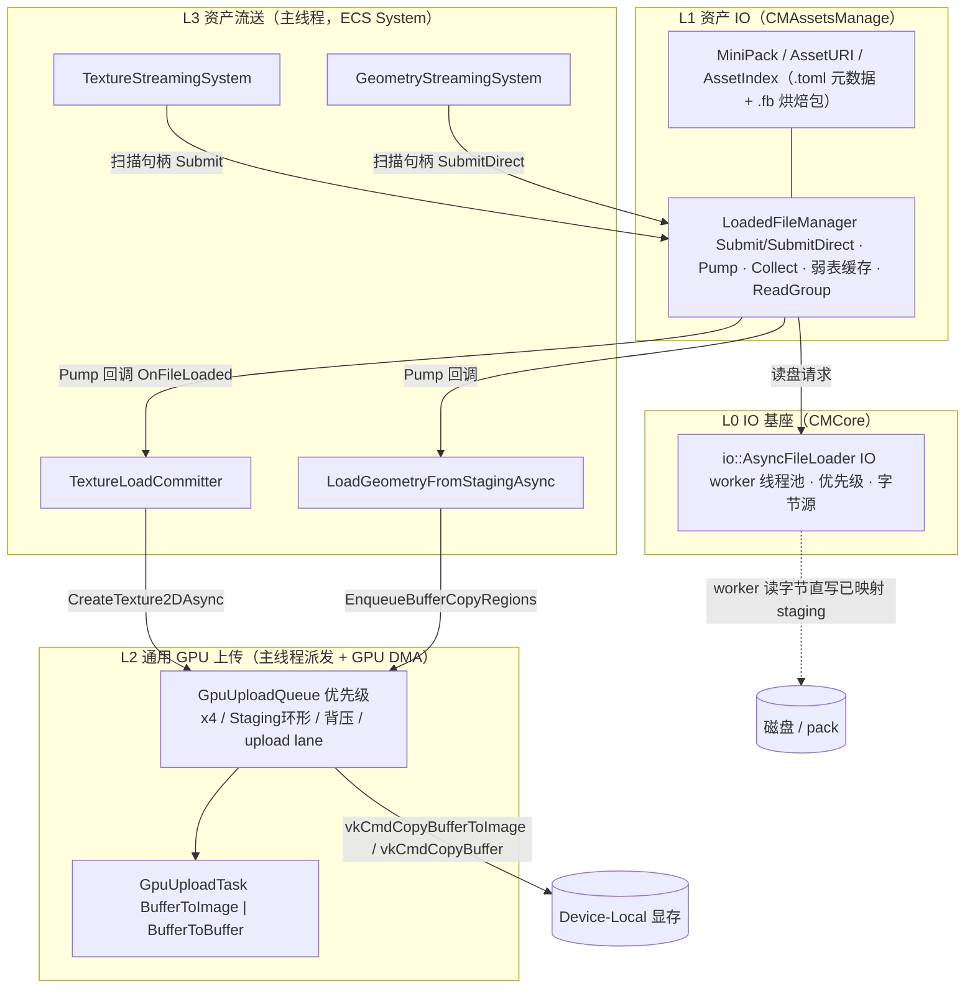
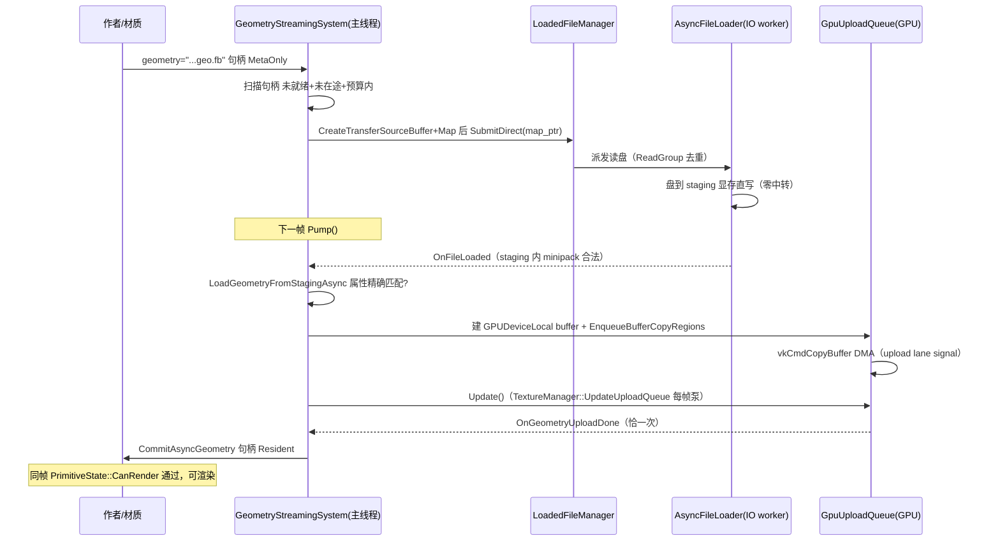

# 异步资产加载体系技术文档

> 覆盖范围：从「磁盘字节」到「可渲染的显存资源」的完整异步管线。
> 分层：**L0 IO 基座（CMCore）→ L1 资产 IO（CMAssetsManage）→ L2 通用 GPU 上传（GpuUploadQueue）→ L3 资产流送（纹理 / 几何）**。
> 关联阅读：`doc/cmassetsmanage-async-loading-structure.md`（资产库结构扫描）、`doc/LoadedFileManager_Handoff.md`（LoadedFileManager 交接记录）。
> 本文对应 2026-11 泛化改造完成后的形态（提交 `684d84464` / `95e2684d8` / `48c1f270a` / `9d0ca1780`）；旧的纹理专用 `TextureUploadTask` / `TextureUploadQueue` 已删除，全部统一为 `Gpu*` 命名。

---

## 1. 设计目标与总原则

| 原则 | 落地方式 |
|------|----------|
| **上传不区分载荷类型** | GPU 侧只认两种硬件 DMA 形态：`BufferToImage`（纹理）与 `BufferToBuffer`（几何 VBO/IBO、SSBO 等任意字节块）。不存在"纹理队列""几何队列"的私有实现 |
| **两段式异步** | 第一段：IO 线程只负责把字节搬进内存；第二段：主线程回调负责解析与 GPU 提交（线程亲和性集中在第二段） |
| **Direct-to-Staging 零中转** | 已知字节数的资产（包内 .fb / 单文件）由 IO worker 直接把盘上的字节写进**已映射的 staging 显存**，跳过 `LoadedFile` 堆缓冲与二次 memcpy |
| **背压受控** | Staging 显存预算（默认 128 MB）同时门控读盘发起与 GPU 派发，忙时宁可当帧不发起 |
| **句柄表即工作集** | 流送系统不维护订阅名单；「有来源 + 未就绪 + 未在途」的句柄集合就是待办集合，不接触 ECS 组件 |
| **自研库纪律** | 全链路零 STL（`AnsiString/UTF8String/OSString`、`hgl::ArrayList/ValueArray/UnorderedMap`、`hgl::Mutex`、`hgl::atom` 等），日志走 `LogXxx` 宏 |

---

## 2. 总体架构



数据流一句话：**盘 → (IO worker) → staging 显存/内存 → (主线程解析/装配) → GpuUploadQueue DMA → device-local 资源 → 完成回调把句柄推入 `Resident`**。

---

## 3. L0：`io::AsyncFileLoader`（CMCore，稳定库）

文件：`CMCore/inc/hgl/io/AsyncFileLoader.h`

- 后台 IO 线程池 + `PriorityTaskQueue`，四级优先级 `AsyncFilePriority{Critical,High,Normal,Low}`（数值越小越优先）。
- 默认 **1 个 worker**：同一块物理盘上并发读互相争道，串行反而更快更稳；未来按设备分流再提线程数。
- `AsyncFileByteSource`：自定义字节源接口，让 worker 能读"不是裸 OS 文件"的字节（包内偏移段等）。`GetRoutePath()` 返回真实物理路径用于按设备路由。
- 错误枚举 `AsyncFileLoadError`：`OpenFailed / SizeUnavailable / AllocationFailed / ReadFailed / DeliveryRejected / BufferTooSmall`。
- 取消是**协作式**的：不会打断正在阻塞的系统调用。

## 4. L1：`LoadedFileManager`（CMAssetsManage 子模块）

文件：`CMAssetsManage/inc/hgl/asset/LoadedFileManager.h`（两段式加载管理器）

### 4.1 核心机制

| 机制 | 说明 |
|------|------|
| **两段式** | `Submit()` 后 IO 线程读整文件进 `LoadedFile` 自带缓冲；主线程周期调 `Pump()` 派发 `LoadedFileHandler` 回调（读盘完成 ≠ 立即可见，回调只发生在 Pump） |
| **弱表缓存** | 已加载表 + 待释放队列共用一把锁：引用归零只入队不销毁；`Collect()` 时仍为 0 才真删；排队期间被 `Find()/Submit()` 命中则 `RefInc` 复活。**只要还有人持 `LoadedFilePtr`，同路径绝不二次读盘** |
| **键规范化** | `MakeLoadedFileKey()`：分隔符统一 + Windows 大小写折叠；`Res\\Image/A.Tex2D` 与 `res/image/a.tex2d` 是同一个文件（回调报告名保留首次拼写） |
| **ReadGroup 合并** | 同路径在途期间的重复 `Submit` 合并进同一分组，只读一次盘，组内每个请求各自收到回调；**组内全部取消才取消底层读** |
| **receiver** | 请求可挂 `thread::TaskReceiver`，完成时投递统一任务事件（每请求至多一个终态事件） |

### 4.2 `SubmitDirect`——Direct-to-Staging 的 IO 侧支撑

```cpp
FileLoadId SubmitDirect(const OSString &filename,
                        void *dest_buffer, int64 dest_capacity,
                        LoadedFileHandler *handler,
                        io::AsyncFilePriority priority,
                        thread::TaskReceiver *receiver,
                        io::AsyncFileByteSource *source,   // 可空；管理器接管所有权
                        void *task_user_data,
                        int64 expected_bytes);             // 在途预算限流；0=不限
```

- IO worker 把字节**直接写进调用方给的缓冲**（几何流送传的是已 `Map()` 的 staging 显存指针），全程无 `LoadedFile` 堆缓冲、无额外拷贝。
- **所有权口径**：缓冲归调用方；`LoadedFile` 引用只授予"字节已落盘"的访问权，任何路径都不会释放它；取消/失败/管理器销毁时由调用方自行回收。
- 每个带 receiver 的请求至多一个终态事件；管理器必须比所有请求和所有 `LoadedFile` 活得更久。

### 4.3 包与字节源

资产以 `.toml`（明文元数据）+ `.fb`（MiniPack 烘焙二进制）双形态共存；包内读取通过 `AsyncFileByteSource` 把「包文件 + 内部偏移 + 长度」伪装成一个可路由的字节流。离线工具 AssetManifestTool 负责 toml→fb 转换并回写 hash。细节见 `cmassetsmanage-async-loading-structure.md` §3.4。

---

## 5. L2：通用 GPU 上传队列（引擎核心，载荷无关）

文件：`inc/hgl/graph/module/GpuUploadTask.h`、`GpuUploadQueue.h`；泵驱动在 `TextureManager::UpdateUploadQueue()`（每帧）。

### 5.1 `GpuUploadTask`（任务描述符）

```cpp
enum class GpuUploadKind : uint8_t {
    BufferToImage,   // Staging Buffer -> VkImage   （纹理/Cubemap/数组）
    BufferToBuffer   // Staging Buffer -> Device-Local Buffer（几何/SSBO/任意字节）
};
```

关键字段（摘录）：

| 组 | 字段 | 说明 |
|----|------|------|
| 通用 | `kind / task_id / priority / backend / state` | 状态机 `Queued -> InFlight -> Completed / Cancelled / Discarded` |
| staging | `staging_buffer / staging_bytes / is_ring_staging / owns_staging / ring_offset` | `owns_staging=false` ⇒ 环形共享或调用方常驻 staging，任务析构不碰它 |
| 纹理支路 | `target_texture / tci / bindless_handle / auto_mipmaps` | `tci` 由任务持有并在析构释放 |
| 缓冲支路 | `target_buffer(BufferOwner*) / dst_offset / copy_size / copy_regions` | `ResolveCopyRegions()` 把单段字段归一化为 1 个 region；**region 数 == 属性数**，`src_offset` 是 staging 内绝对偏移 |
| 回调 | `on_complete(GpuUploadTask*, void*) / user_data` | 由 `Update()` 在任务完成（或 Discarded 清理后）**恰一次**触发 |

析构负责回收 `staging_buffer`（非 ring 且 owns 时）与 `fence/tci`；`target_buffer` 归资产方所有。

### 5.2 `GpuUploadQueue`（调度器）

- **四级优先级就绪队列**（`UploadPriority::Immediate/High/Normal/Low`）+ 在飞表 + `all_tasks_` ID 索引。
- **双队列后端**：专用 Transfer 队列 DMA（`GpuTransferDma`）/ Graphics 队列 DMA（`GpuGraphicsDma`，需 Blit 生成 mipmap 时用）；`Auto` 自动判定。
- **Staging 环形缓冲 + 预算背压**：`max_staging_bytes_` 默认 **128 MB**（`SetMaxStagingMemory` 可调）。派发前检查 `GetCurrentStagingMemory()+bytes <= GetMaxStagingMemory()`，超预算任务留在队列。
- **跨队列同步 = 单条 upload lane（timeline semaphore）**：每次 transfer 派发 signal 一个递增值；主帧提交前对 `GetUploadLaneValue()` 等待一次即可覆盖**全部**在飞 DMA。
  > 为什么不是逐任务信号量（历史教训，代码注释同样保留）：① 批次完成任务的 sem 在批次执行完毕前仍 in use，任务析构 `vkDestroySemaphore` 踩 VUID-vkDestroySemaphore-semaphore-05149；② 收集数量可能超过主帧 waits 上限，溢出丢弃 = 无等待裸用刚拷贝的资源。
- **取消语义**：`CancelUpload(id)`——Queued ⇒ 移出并标 `Cancelled`；InFlight ⇒ 标 `Discarded`，GPU 完成后静默销毁、不更新描述符。

主要入口：

```cpp
uint64_t Enqueue(GpuUploadTask *task);                    // 通用入队，返回任务 ID
uint64_t EnqueueBufferCopy(DeviceBuffer *staging, VkDeviceSize src_offset,
                           BufferOwner *target, VkDeviceSize dst_offset, VkDeviceSize size,
                           UploadPriority, on_complete, user_data, bool owns_staging=true);
uint64_t EnqueueBufferCopyRegions(DeviceBuffer *staging, BufferOwner *target,
                           const ValueArray<BufferCopyRegion> &regions, ...);
void     Update();            // 帧轮询：回收完成(含触发 on_complete) + 按优先级/背压派发
void     WaitTask(uint64_t);  // Immediate 任务同步等待
void     ExtractCompletedTasks(ValueArray<GpuUploadTask*>&); // Bindless 更新交接
```

### 5.3 `BufferAllocPolicy::GPUDeviceLocal`

`BufferToBuffer` 目标缓冲的分配策略：**纯 device-local**（`MemoryUsage::GPUOnly` + `VK_BUFFER_USAGE_TRANSFER_DST_BIT`），创建时强制 `data=nullptr`——`CreateBuffer` 携带数据会对不可主机写内存执行 `dm->Write`；内容由 DMA 填充，`staged_source` 恒为 null，析构路径不再尝试 Unmap。

---

## 6. L3：资产流送层

### 6.1 纹理链路

组件与职责：

| 组件 | 文件 | 职责 |
|------|------|------|
| `TextureAsset` | `inc/hgl/graph/asset/TextureAsset.h` | 句柄状态机：`MetaOnly / Loading / Resident / LoadFailed`；`MarkAsyncRequested / ClearAsyncRequest / CommitAsyncTexture / MarkLoadFailed` |
| `TextureStreamingSystem` | `src/ecs/systems/render/streaming/TextureStreamingSystem.cpp` | 唯一引擎侧驱动者：每帧 `Pump()` 派发回调 → `AcquireOneFrame()` 扫描句柄表提交读取 → `Collect()` 回收引用 |
| `TextureLoadCommitter` | `inc/hgl/graph/module/TextureLoadCommitter.h` | 两段式"第二段"：在 Pump 回调线程把 `LoadedFile` 字节解析成 `TextureCreateInfo` 并提交上传队列 |
| `TextureManager` | `inc/hgl/graph/module/TextureManager.h` | 句柄表宿主；`LoadTexture2DAsync / CreateTexture2DAsync` 入口；每帧 `UpdateUploadQueue()` 泵 `GpuUploadQueue` 并做 Bindless 更新 |

关键时序性质：

- 相位固定 `ExecutionPhase::RenderPreBeginFrame`，**必须早于紧随其后的 `UpdateUploadQueue`**，否则本帧提交的上传要等下一帧。
- `VkTextureLoader::Load` 期间已把像素**同步拷进已映射 staging 缓冲**，函数返回后 `LoadedFile` 字节即不再被需要，回调里可立刻放手引用。
- 同步路径收敛：发起读盘前先 `FindTextureByFilename()`——若同步路径早已加载同一文件，直接 `CommitAsyncTexture` 命中项，不二次读盘。
- **就绪 ≠ 可采样**（RenderTarget 句柄）：`Resident` 只表示容器（VkImage/VkImageView）存在；RT 内容就绪需生产方 `MarkRenderTargetContentReady()` 显式置位，避免第一帧把清屏色当内容采样。
- 消费端"未就绪不渲染"由 `PrimitiveState::CanRender` 每帧现算 `MaterialData::HasPendingRequiredTexture()`，无缓存、无失效通知；句柄转入 `Resident` 的同一帧就能被收集看到。

### 6.2 几何链路（与纹理事件流同构）

组件与职责：

| 组件 | 文件 | 职责 |
|------|------|------|
| `GeometryAsset` / `GeometryAssetRegistry` | `inc/hgl/graph/asset/...` | 几何句柄状态机与句柄表（工作集=注册表；内置几何 `SetupFromSpec` 创建即 `Resident`，不经流送） |
| `GeometryStreamingSystem` | `inc/hgl/ecs/systems/render/streaming/GeometryStreamingSystem.h` + `src/ecs/systems/render/streaming/GeometryStreamingSystem.cpp` | 每帧 `Pump -> AcquireOneFrame -> Collect`；持有直写登记（`direct_buffers / direct_all / direct_bytes / upload_jobs`） |
| `LoadGeometryFromStagingAsync` | `inc/hgl/graph/geo/LoadGeometry.h` | staging 内 minipack -> Geometry：判定 DMA 直通或同步回退 |

`AcquireOneFrame` 的资格判定 + Direct-to-Staging 发起：

```
payload = QueryPayloadBytes(filename)                    // 预知字节数
若 upload_queue 存在且 payload 已知可路由:
    且 direct_bytes + payload <= upload_queue->GetMaxStagingMemory():   // ① 系统侧预算门
        staging = tex_manager->CreateTransferSourceBuffer(payload)      // ② 借纹理路径的 staging 工具
        map_ptr = staging->Map(0, size)                                  // ③ 提前映射
        id = load_manager->SubmitDirect(filename, map_ptr, payload,
                                        handler, priority, ..., payload) // ④ IO worker 直写显存
        登记 direct_buffers（IO 失败时由调用方回收）
否则:
    load_manager->Submit(filename, handler, priority, nullptr, nullptr, payload) // ⑤ 经典路径
```

Pump 回调分支（`OnFileLoaded`）：

- **直写分支**：staging 中 minipack 合法 -> `LoadGeometryFromStagingAsync`：
  - 全部顶点属性与目标 `geometry_vertex_format` **精确一致**且索引为 U32（或无索引）⇒ 建 `GPUDeviceLocal` 的 GeometryData，region 数=属性数，走 `EnqueueBufferCopyRegions` DMA；staging 由内部以 `owns_staging=false` 挂接上传任务、统一 `Unmap+delete`（所有权已移交本函数，避免双删）；
  - 任一属性需格式转换（Normal float3->RG8/Half、TexCoord->Half、U8/U16 索引展开等）⇒ 回退**同步** `LoadGeometryFromMiniPackBytes`。两条路径 `on_complete` 都**恰好回调一次**（回退路径在返回前同步回调）。
  - DMA 完成回调 `OnGeometryUploadDone`：再解析一次**只取句柄**（不建 buffer）-> `CommitAsyncGeometry`。
- **经典分支**：staging 预算不足（预算二道闸）或直写未发起/已回收 -> `MemoryAsReader`（对 `MiniPackMemory` 的 `ReadFile` 适配器）内存解析 -> 同步建 buffer（staged 路径）。

其他要点：

- `GeometryStreamingSystem::Shutdown()` 有**泵送循环**（最多 3000 次 x1ms）等在飞 DMA 任务自然完成后再放行析构——`GpuUploadQueue` 析构删除任务**不触发回调**，不泵就会丢资产提交。
- headless（无 GraphicsContext）下 `upload_queue` 为空 ⇒ 自动退回经典路径；单测环境无 GPU，DMA 运行分支不被覆盖，属设计安全分支。

### 6.3 失败与重试语义（纹理/几何一致）

- 读取或解析/上传失败 ⇒ 句柄停在 `LoadFailed`，系统**不自动重试**（防止坏文件每帧重读磁盘刷屏），留 error 日志，该图元持续不渲染。
- 需要重试：调用方 `ClearAsyncRequest()` 把句柄放回待办集合。
- 直写任务的 IO 失败（`OnFileFailed/OnFileCancelled`）：句柄推 `LoadFailed` + 撤销 async 标记，同时**回收调用方持有的 staging**（从登记表移除并销毁）。

---

## 7. 端到端时序（几何为例）



---

## 8. 线程契约速查

| API | 允许线程 |
|-----|----------|
| `LoadedFileManager::Submit / SubmitDirect / Cancel / Pump / Collect / Stop` | **仅主线程**（同一调用线程） |
| `LoadedFileManager::Find`、`LoadedFile::RefInc/RefDec` | 任意线程 |
| `AsyncFileByteSource::GetSize/Read` | 仅处理该请求的那一个 IO worker（实现无需自锁） |
| `TextureLoadCommitter::Commit*` | 仅主线程（Pump 回调所在线程） |
| `GpuUploadQueue::Enqueue*/Cancel/Update/Extract*` | 仅主线程 |
| `GetUploadLane()/GetUploadLaneValue()` | 主线程渲染提交处读取 |
| 流送系统 `Update()` | 由 ECS 于 `RenderPreBeginFrame` 相位驱动 |

## 9. 所有权与生命周期规则

| 对象 | 谁创建 | 谁销毁 | 坑 |
|------|--------|--------|----|
| `LoadedFile` | 管理器（表内） | `Collect()` 弱表回收 | 排队期间可被复活；管理器必须比所有 LoadedFile 活得久 |
| Direct staging（几何） | 流送系统（`CreateTransferSourceBuffer` + 提前 `Map`） | `LoadGeometryFromStagingAsync` 内部统一 `Unmap+delete`；失败/取消走登记表回收 | 上传任务 `owns_staging=false` 挂接，防双删 |
| `GpuUploadTask` | 提交方 new | `GpuUploadQueue`（完成/取消/析构） | 队列析构删任务**不触发回调** ⇒ Shutdown 先泵 |
| `target_buffer(BufferOwner)` | 资产方 | 资产方 | 任务与队列都不碰它的生命周期 |
| `handler`（StreamHandler 等） | 流送系统 | 最后一级回调 `DeleteMe` | 必须活到最后一个回调 |

## 10. 主要文件地图

| 层 | 文件 |
|----|------|
| L0 | `CMCore/inc/hgl/io/AsyncFileLoader.h` |
| L1 | `CMAssetsManage/inc/hgl/asset/LoadedFileManager.h`、`CMAssetsManage/src/LoadedFileManager.cpp` |
| L2 | `inc/hgl/graph/module/GpuUploadTask.h`、`inc/hgl/graph/module/GpuUploadQueue.h` |
| 纹理 | `inc/hgl/graph/module/TextureManager.h`、`TextureLoadCommitter.h`、`inc/hgl/graph/asset/TextureAsset.h`、`inc/hgl/graph/texture/TextureMemoryLoader.h`、`src/SceneGraph/texture/VKTexture2DLoader.cpp`、`src/ecs/systems/render/streaming/TextureStreamingSystem.cpp` |
| 几何 | `inc/hgl/ecs/systems/render/streaming/GeometryStreamingSystem.h`、`src/ecs/systems/render/streaming/GeometryStreamingSystem.cpp`、`inc/hgl/graph/geo/LoadGeometry.h`、`src/SceneGraph/geo/GeometryLoader.cpp` |
| 示例/测试 | `example/Texture/AsyncTextureUpload.cpp`、`example/Loader/LoadedFileManagerTest.cpp`、`TestModelStreamingSystem`、`async_load_test` |

## 11. 维护须知（Do & Don't）

- ❌ **不要**新增按载荷类型划分的上传队列/任务——新资产形态只需选 `BufferToImage` 或 `BufferToBuffer` 支路并给出 copy regions。
- ❌ **不要**恢复跨队列的"逐任务信号量"；等待一律走单条 upload lane（timeline）。
- ❌ **不要**在引擎代码引入 STL（`std::string/vector/mutex/...`、裸 `new/delete` 管内存、`printf/cout` 日志）；唯一例外子树 `src/Tools/TexConv`（见仓库编码规范）。
- ✅ 新增流送链路照抄模板：`扫描句柄 -> Submit/SubmitDirect -> Pump -> OnFileLoaded -> GPU 提交 -> Commit ->（同帧）CanRender`，相位必须早于渲染收集。
- ✅ Direct-to-Staging 的字节数若不可路由，`Submit()` 会回退完整读取，语义仍正确，只是少一次零拷贝优化。
- ✅ 回归测试从**仓库根目录**运行（`TestLoadedFileManager`、`TestTextureArraySpec` 依赖相对路径）。
- ⚠️ DMA 直通比例可观测性：`direct_bytes / direct_all` 已在 handler 内登记，尚未暴露统计接口；需要时加 getter 即可。
