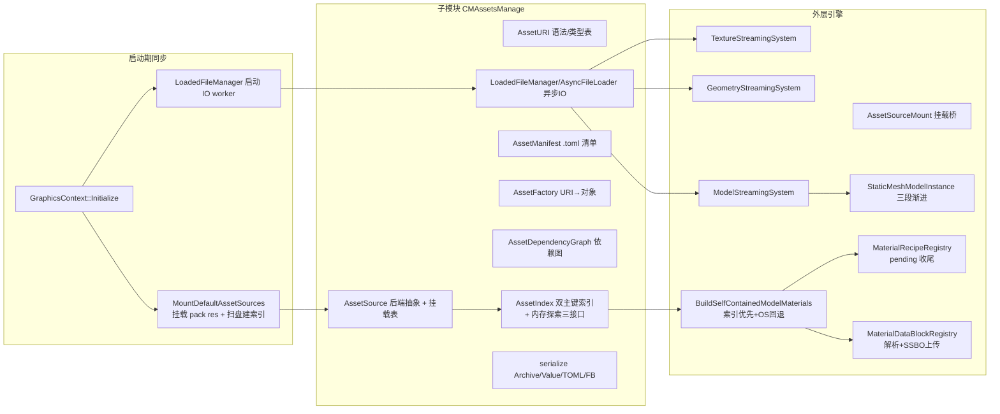
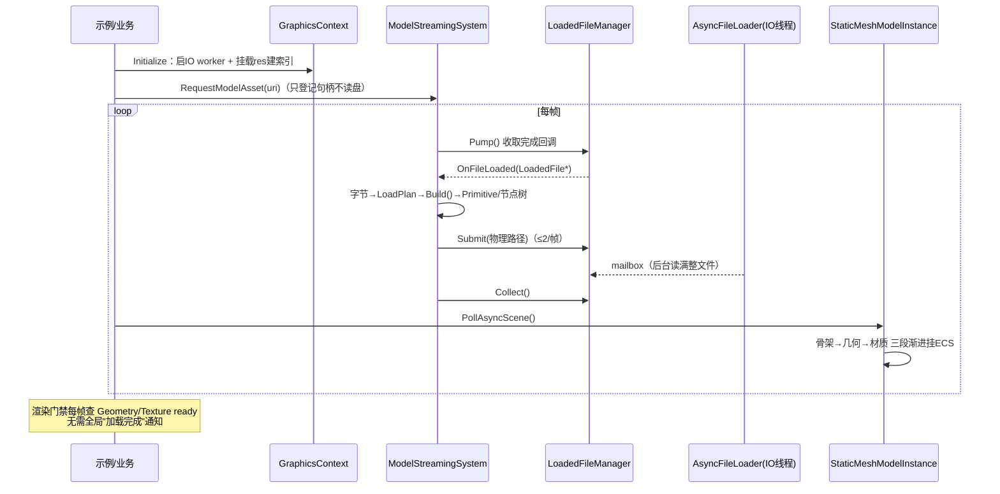

# CMAssetsManage 与异步加载体系：结构性扫描总结

> 扫描基线：分支 `feature/asset-memory-index`（外层 `e8d9b6a63` / 子模块 `8f39bba`），2026-11-07。
> 范围：`CMAssetsManage/`（资产管理子模块）+ 外层引擎 `src/SceneGraph`、`src/ecs`、`inc/hgl/graph` 的异步加载体系。
> 证据均为"路径:行号"格式，路径相对 `E:\ULRE`。

---

## 1. 一页总览

整个体系**不是单一的统一异步资产状态机**，而是若干条互相衔接的轴：



核心设计特征：**后台线程只负责文件字节；解析、句柄状态推进、GPU 资源创建与上传提交全部在主线程（`Pump()` 回调线程）发生。**

| 轴 | 承载者 | 异步性 |
|---|---|---|
| 资产来源 | `AssetSourceMount` → `pack(res)` 挂载 + 索引 | 启动期同步 |
| 原始 IO | `AsyncFileLoader` + `LoadedFileManager` | 后台线程 |
| 句柄状态 | `AssetState` / `PayloadState` / 模型级状态机 | 主线程推进 |
| GPU 提交 | `TextureLoadCommitter`、几何 buffer 创建 | 主线程回调内 |
| 模型装配 | `ModelStreamingSystem` 每帧三段 | 逐帧 |
| 消费门禁 | 渲染系统每帧查询 ready，无全局完成通知 | 逐帧 |

---

## 2. CMAssetsManage 结构（子模块）

### 2.1 四层分层

1. **资产定位与管线层** `inc/hgl/asset`（14 个公共头）
2. **资产对象生命周期层** `inc/hgl/object`（MetaObject）
3. **通用序列化层** `inc/hgl/serialize`（9 个公共头）
4. **异步原始文件加载层** `hgl/asset/LoadedFile*`（底座是 CMCore 的 `AsyncFileLoader`）

### 2.2 inc/hgl/asset 头文件职责

| 头文件 | 一句话职责 |
|---|---|
| `AssetAnnotation.h` | `HGL_ASSET_STRUCT`/`HGL_PROPERTY` 等 Clang 注解宏，供 AssetGen 提取元数据 |
| `AssetDependencyGraph.h` | 正/反向依赖边、传递闭包、拓扑排序、环检测（`:63-161`） |
| `AssetFactory.h` | URI→`AssetObject` 加载器注册表；未注册类型降级 `GenericAssetObject`（`:106-153`） |
| `AssetID.h` | 128 位 UUIDv7 身份、严格/宽松文本解析、ID URI、源文件头部 ID 注入（`:69-170`） |
| `AssetIndex.h` | `AssetIndexEntry` + 双主键 `AssetIndexTable`；逻辑路径推导、探索查询（`:135-280`） |
| `AssetManifest.h` | `.asset_manifest.toml` 的版本、包名、包级哈希算法与读写（`:66-145`） |
| `AssetObject.h` | 资产反射元数据、`AssetState` 装配状态机、多态基类（`:37-331`） |
| `AssetSource.h` | 后端抽象（目录/未来 pak）、挂载表、索引桥接虚接口（`:90-261`） |
| `AssetStream.h` | `OpenAssetStream()`：URI → 实际字节流的统一分派（`:46-64`） |
| `AssetURI.h` | 类型表、来源类型、`pack(name)` 语法、URI 解析/规范化（`:16-224`） |
| `LoadedFile.h` | 带 MetaObject 生命周期与引用计数的已加载原始文件 |
| `LoadedFileHandler.h` | 异步加载回调接口：成功/失败/取消（`:10-58`） |
| `LoadedFileManager.h` | 两阶段异步文件管理器：IO 线程读 + `Pump()` 提交；缓存/合并/延迟释放（`:88-327`） |
| `SystemPath.h` | 跨平台系统路径（exe/AppData/临时目录/外部资产目录） |

`inc/hgl/object/MetaObject.h`：两阶段资源生命周期——元信息 Init/Release 与载荷 Load/Unload；`PayloadState` 支持 `MetaOnly ⇄ Resident` 往返（`:86-160`）。与 `AssetState` 正交。

`inc/hgl/serialize` 9 头：`Archive`（双向游标，一份 `Do()` 读写共用）、`ArchiveFile`（按扩展名分派 TOML/FlatBuffers）、`Value`（通用有序值树 DOM）、`TomlCodec`/`FlatCodec`（值树↔两种格式）、`Traits`/`Container`/`EnumMeta`/`MetaSchema`（类型映射、容器适配、严格键校验）。

### 2.3 src 与 CMake

19 个 `.cpp`（`SystemPath*` 五平台互斥，Windows 只编 `SystemPathWindows.cpp`），库目标 `CMAssetsManage`，PUBLIC 依赖 `CMCore`/`CMMath`，PRIVATE 依赖 `toml11`/`flatbuffers`；离线工具 `AssetManifestTool`（依赖 CMHash）经 `CMASSETS_BUILD_TOOLS` 开关构建（`src/CMakeLists.txt:91-131`）。测试经 `add_assets_test()` 注册 CTest 并带 label（`test/CMakeLists.txt:9-84`）。

---

## 3. 核心工作流

### 3.1 AssetURI：定位语法

- 类型表唯一拼写：`geo` `tex` `rcp` `prim` `model` `mtldata` `env`（`CMAssetsManage/inc/hgl/asset/AssetURI.h:68-84`）。
- 来源：`builtin` / `file` / `rt` / `pack(name)`（`:86-101`）。
- 语法四形态：`<type>:<source>:<target>`、`<type>:<target>`、`<source>:<target>`、裸 `<target>`；解析只切前两个冒号，Windows 盘符与 RT attachment 冒号不被误拆（`src/AssetURI.cpp:157-175, 293-382`）。
- `ParseAssetType` 契约：ASCII 大小写不敏感、不 Trim、未知→`Unknown`（`src/AssetURI.cpp:24-41`）。
- `pack(name)`：名称 1–32 字符、仅 `[A-Za-z0-9_-]`、保留大小写（`src/AssetURI.cpp:76-145`）。

### 3.2 AssetIndex：一次扫盘，内存查询为主

- 条目字段：`id/type/logical_path/physical_path/size/mtime/content_hash/source_file/source_hash/bake_time/is_baked`（`inc/hgl/asset/AssetIndex.h:57-92`）。
- 双主键：`AssetID→Entry` 与 `(type, logical_path)→AssetID`；路径键 ASCII 大写折叠（`src/AssetIndex.cpp:222-249`）。
- `DeriveLogical`：统一 `\`→`/`，先剥格式后缀（`.toml/.fb/.flat/.bin`）再剥类型后缀（短拼写），`declared_type` 优先（`src/AssetIndex.cpp:150-218`）。
- **磁盘历史别名**（仅扫盘路径生效，URI 契约不动）：`.recipe→rcp`、`.material_data→mtldata`、`.primitive→prim`（`src/AssetIndex.cpp:75-103, 190-195`）。res 实际资产大量使用历史拼写，靠此进入索引。
- 三大内存探索接口（`src/AssetIndex.cpp:752-835`）：
  - `GetEntriesByType(type, out)`——按类型收集，追加，返回新增数；
  - `FindInDirectory(logical_dir, type, out, recursive)`——`\`/`/` 等价、大小写折叠、空串=包根、`Unknown` 不限类型；
  - `FindByPathPrefix(prefix, type, out)`——等于前缀或 `prefix + "/"` 子树；不会 `her` 误中 `hero`；空前缀返回 0。
- 通过 `AssetSource` 基类桥接为虚接口：`GetEntriesByType/FindInDirectory/FindByPathPrefix/Exists(AssetID)/Open(type,logical)/ResolvePath(...)` 默认落到 `GetIndexTable()`（`src/AssetSource.cpp:127-197`）。未来 `.pak` 后端只需实现 `Open/Stat/ListDirectory` + 建索引覆写 `GetIndexTable()` 即自动获得全部查询。

### 3.3 挂载与目录后端

- 挂载流程：`CreateSourceByFilesystem → RebuildIndex() → RegisterAssetsSource()`，**先建索引再登记**，避免来源可见而索引未就绪（`src/AssetSourceFilesystem.cpp:616-656`）。
- 索引重建：读旧清单 → 递归扫盘 → 按逻辑路径分组源/产物 → 裁决有效物理文件 → 复用 ID/哈希 → `TryAddStrict` 写新表 → `CopyFrom` 一次性替换 → 按需保存清单（`:237-506`）。
- 伴生裁决：`.toml` 为作者态源；`.fb/.flat/.bin` 为烘焙态。产物 `mtime >=` 源 → 选产物；产物过旧 → 回退源并警告；索引记 `is_baked/source_file/source_hash/bake_time`（`:306-407`）。
- ID 延续优先级：**源文件头部 ID → 产物头部 ID → 旧清单复用 → 新生成 UUIDv7**（`src/AssetSourceFilesystem.cpp:419-463`）。`size+mtime` 均未变则复用旧 `content_hash`，任一变化作废旧哈希。
- `OpenAssetStream()` 严格分派：`pack(name)` 查挂载表；`id:<32hex>` 只走 ID 不回退；**有索引未命中直接失败，绝不后缀试探**（`src/AssetStream.cpp:32-112`）——保证目录开发态与发行包后端行为一致。
- 全局挂载表 `Register/Unregister/GetSource/ClearAssetsSource`，`RWLock` 保护（`src/AssetSource.cpp:199-263`）。

### 3.4 Pack / Manifest / HASH

- **当前没有独立 `AssetPack` 类**：Pack = `pack(name)` URI + 挂载表 + 目录后端 + 索引 + `.asset_manifest.toml` + 离线工具 的组合（`doc/Pack.md`）。
- 运行期挂载只比 `size+mtime`，**不读全文件算哈希**；内容哈希由离线 `AssetManifestTool` 计算，支持 `--check-only/--update/--no-hash/--write-id/--algo`（`src/Tools/AssetManifestTool/main.cpp:292-351`）。
- 默认算法实际代码是 `XXH3-128`（开发态求速），发行出包可指定 `BLAKE3`；`hash_algorithm` 是**包级**字段。⚠️ 部分注释/文档仍写"默认 BLAKE3"，存在文实不一致（`inc/hgl/asset/AssetManifest.h:66-73` vs `doc/AssetDependency.md:17-57`）。
- `PACK_NAME`：URI 层限 1–32 字符 `[A-Za-z0-9_-]`；清单层 `SanitizePackName()` 截取末级名、**拒绝绝对路径入库**（`src/AssetManifest.cpp:210-238, 570-580`）。

### 3.5 AssetFactory 与依赖图

- 工厂：`Register(type, loader)` → `Create(URI)`；类型未知用 `default_type`；未注册可降级 `GenericAssetObject`；批量 `Create()` 保持输入序、单个失败不断链（`src/AssetFactory.cpp:27-159`）。
- 依赖图：`forward[A]=A 依赖的`、`reverse[B]=引用 B 的`；`RegisterDependencies` 整体替换+去重+去自环；`CollectDependencies/Dependents` BFS 闭包；`TopologicalOrder` Kahn，**被依赖者在前**可直接作装载序（`src/AssetDependencyGraph.cpp:43-473`）。
- ⚠️ 子模块内**没有集成式 `LoadGraph` 调度器**——URI→工厂→依赖登记→拓扑序→装载，目前需调用方（外层）自己串联。

### 3.6 库内异步 IO 体系（两阶段）

```
Submit() ──┬─ 命中已加载表 → ready（不读盘）
           ├─ 同路径在途   → 合并进同一 ReadGroup（不重复读盘，各请求仍独立回调）
           └─ 新路径       → LoadedFile + AsyncFileLoader 后台读
IO worker 读满整文件 → SwapMailbox → 调用线程 Pump() → LoadedFileHandler 回调
```

- `Submit/Cancel/Pump/Collect/Stop` 限同一调用线程（通常主线程）；handler 回调都在 `Pump()` 线程执行——这解决了 IO worker 不能触碰 GPU 的问题（`inc/hgl/asset/LoadedFileManager.h:76-91`）。
- 引用归零不立即销毁：进 `pending_release`，`Collect()` 时仍为 0 才释放；期间 `Find/Submit` 可复活缓存（`src/LoadedFileManager.cpp:108-182`）。
- 底层 `AsyncFileLoader`（CMCore）：共享优先级队列 + 固定 worker，数值小优先级高；取消协作式，不打断阻塞中的 OS 读（`CMCore/inc/hgl/io/AsyncFileLoader.h:84-88, 147-190`）。

---

## 4. 外层异步加载体系（src/SceneGraph + src/ecs）

### 4.1 挂载层

- `AssetSourceMountConfig{ name, root, build_index=true, load_manifest=true, save_manifest=false, only_read=true }`（`inc/hgl/graph/asset/AssetSourceMount.h:30-39`）。
- `MountAssetSource`：幂等（同名直接成功）→ 校验目录 → 转 `AssetsSourceMountOptions` → `CreateSourceByFilesystem`（**索引构建发生在挂载内**）→ 统计条目数记日志（`src/SceneGraph/asset/AssetSourceMount.cpp:45-108`）。
- `MountDefaultAssetSources`：默认 `name="res"`、`root="res"`（相对 CWD）；**res 缺失不算错误**，仅记 notice 返回 false，旧路径示例照常启动（`:106-123`）。
- `GraphicsContext::Initialize` 时序：建 `LoadedFileManager` → 启 1 个 IO worker → `MountDefaultAssetSources()` → 模块/GPU 初始化（`src/SceneGraph/render/GraphicsContext.cpp:246-270`）；关闭反序：先停文件管理器再注销包裹（`:293-309`）。
- `ResolveAssetPhysicalPath`：`pack(...)` 用挂载时保存的物理根拼路径；裸路径/`file:` 直通（`src/SceneGraph/asset/AssetSourceMount.cpp:135-164`）。物理根映射表 `mount_roots` 存在的原因：`LoadedFileManager::Submit()` 只认物理路径（`:20-42`）。

### 4.2 句柄状态机（三条正交轴）

| 轴 | 用途 | 状态 |
|---|---|---|
| `AssetState`（子模块） | 业务装配 | `Unloaded→Loading→Parsed→Ready`，失败 `Failed`（`CMAssetsManage/inc/hgl/asset/AssetObject.h:262-270`） |
| `PayloadState`（MetaObject） | 载荷驻留 | `MetaOnly⇄Resident`，可反复卸载重载 + `LoadFailed`（`inc/hgl/object/MetaObject.h:13-40`） |
| 模型级（ModelAsset） | 流送专用 | `Unloaded→Loading→Assembling→Ready/Failed`（`inc/hgl/graph/asset/ModelAsset.h:56-64`） |

按句柄细分：

- **MaterialRecipeAsset**：初始 `Parsed`；本体读取/解析**同步**；`Ready` 由校验/构建决定；纹理异步不占其状态机，用 `AreTexturesResident()/GetPendingTextureCount()` 另行查询（`inc/hgl/graph/asset/MaterialRecipeAsset.h:75, 112-164`）。
- **MaterialDataBlockAsset**：初始 `Parsed`；`Upload()` 进 GPU SSBO 行池才 `Ready`；池未绑定/池满等软失败保持 `Parsed` 只记 `failure_reason`；`IsUploaded()` 看行租约（`inc/hgl/graph/asset/MaterialDataBlockAsset.h:79, 122-171`）。
- **GeometryAsset / TextureAsset**：真流送句柄，走 `PayloadState`：`MetaOnly →MarkAsyncRequested→ Loading →CommitAsync*→ Resident`；内置几何 `SetupFromSpec()` 同步直达 `Resident`；RenderTarget 的 `Resident` 还需生产方 `MarkContentReady()`（`inc/hgl/graph/asset/TextureAsset.h:27-38, 113-157`）。
- 模型句柄只在主线程推进，后台 IO 不改状态（`inc/hgl/graph/asset/ModelAsset.h:99-104`）。

### 4.3 注册表

**MaterialRecipeRegistry**（`src/SceneGraph/asset/MaterialRecipeRegistry.cpp`）：

- `LoadFile`：一次读入→`RegisterRecipeSource`（TOML 解析、重名检查、入表、立即 `ResolvePending()`）。
- 继承关键语义：父配方不存在或未 Ready 时，子配方停在 `Parsed` 留在表中；`ResolvePending()` **多轮扫描直到无进展**——子先于父加载也能收敛（`:383-446`）。
- 连续 `LoadFile()` 的调用方**必须批次末尾显式 `FinalizePending()`**：把父缺失/父成环的句柄标 `Failed` 并摘除（`:477-507`）。`LoadDirectory` 内部已自动调用（`:297-301`）。
- `FindByName()` 只暴露 Ready；`FindAssetByPath()` 按来源路径查（`:509-538`）。

**MaterialDataBlockRegistry**（`src/SceneGraph/asset/MaterialDataBlockRegistry.cpp`）：

- 三格式：`.material_data.toml` / `.mdb`（MDB1 二进制）/ `.fb`（FlatBuffers），按后缀分派（`:370-410`）。
- `LoadFile/LoadDirectory` 只解析建句柄不碰 GPU；`UploadAll(pool)` 才上传（`nullptr` 为软失败）（`:468-497`）。
- 消费入口链：`GetRowBinding(uri, row) → GetOrLoadURI → LoadFile → Upload(pool) → GlobalSSBOBinding`（`:424-465`）。

**AssetLoadGraph**（外层，`src/SceneGraph/asset/AssetLoadGraph.cpp`）：子模块 `AssetDependencyGraph` 的资产引用版——物理引用规范化成 `{AssetType, logical_path}`、正/反向边+引用计数、`SolveClosure()` 非递归 DFS 后序=依赖优先序、遇环返回 false 但尽量出闭包（`:304-499`）。测试为纯逻辑测试（`src/ecs/tests/TestAssetLoadGraph.cpp:20-290`）。

### 4.4 模型流送（ModelStreamingSystem）

每帧固定节拍（`src/ecs/systems/render/streaming/ModelStreamingSystem.cpp`，见 `Update()` 相位注释）：

```
Pump() → PruneStreams() → PumpMaterialLane() → AcquireOneFrame() → Advance() → Collect()
```

- **AcquireOneFrame**：每帧最多提交 2 个模型包（`kMaxSubmitPerFrame=2`）。所有 URI（目录型物理文件、`pack(res):id:<hex>`、归档包裹、`builtin`）统一提交给 `LoadedFileManager`：能映射物理路径的走真实路径键读盘，映射不了的以 `AssetURIByteSource` 自定义字节源在同一条读盘通道上取流（表键用完整 URI 文本），由 `StreamHandler` 中继回收 —— 主线程不再有同步取流分支，也没有单独的包裹 CPU 池。
- **配方扇出 + 门禁**：`SetPlan()` 之后做一次性 `FanOutMaterialDeps()`（场景目录里的配方全部投给 `MaterialAsyncLoadLane`），内容装配前用 `GraphicsContext::IsMaterialAsyncLoadPending()` 做**软门禁**：几何就绪仍是唯一硬门禁，配方缺席回退默认配方，不会把模型卡在 Loading。
- **Advance** 三阶段：
  - B-1 字节就绪 → `BuildModelLoadPlanFromBytes()` 出计划单 → `SetPlan()`；
  - B-2 `ModelStreamingRequest::Build()` 产出 PrimitiveAsset/节点树，以实际图元数替换计划子项计数；
  - C 逐帧统计 `PrimitiveAsset::IsGeometryReady()`，增量结算 `SettleAllChildren()`，全落定 `CommitModel()`。
- **就绪门禁是图元几何**，不要求所有纹理/材质 Ready（`inc/hgl/ecs/systems/render/streaming/ModelStreamingSystem.h`）。

### 4.5 三段渐进实例化（StaticMeshModelInstance）

流送系统只管"得到模型内容并推状态"，接进 ECS 由消费方分三段（`src/SceneGraph/asset/StaticMeshModelInstance.cpp:56-345`）：

1. `InstantiateSkeleton`：实体+Transform 入世界，相机即可对焦（几何还没来）；
2. `AttachGeometries`：图元实体+GeometryData 挂载，未 Ready 的由渲染门禁拦绘制；
3. `AttachMaterials`：按材质行绑定补全 `MaterialData`。

示例 `LoadModel` 用环境变量切换：默认异步三段（`PollAsyncScene()` 逐帧接线，`example/Geometry/LoadModel/LoadModel.cpp:457-548`），`LS_SYNC=1` 回同步 `TryLoadModel()`（`:224-250`）。

### 4.6 纹理事件流

- `TextureStreamingSystem` 每帧：`Pump()` →（回调内）`TextureLoadCommitter` 拷字节进 staging → GPU 上传 → `CommitAsyncTexture()` + 文件名缓存注册；再扫描 `TextureManager` 句柄表每帧最多补投 2 个读请求 → `Collect()`（`src/ecs/systems/render/streaming/TextureStreamingSystem.cpp:18-47, 205-272`）。
- 回调策略统一："回调内消费字节，不保留文件对象"——几何解析后即释放；模型复制字节进自有缓冲（`src/SceneGraph/mesh/ModelStreaming.cpp:91-127`）；纹理同步拷入 staging（`src/SceneGraph/module/TextureLoadCommitter.cpp:12-38`）。
- TextureArray 两套并存：运行时 `TextureManager::BuildTextureArray()` 同步构建（`src/SceneGraph/module/TextureManager.cpp:304-351`）；示例级逐层异步流送（`example/Texture/TextureArrayStreaming.cpp:299-359`）。

### 4.7 材质自装配消费链（BuildSelfContainedModelMaterials）

`src/SceneGraph/mesh/LoadStaticMesh.cpp:870-1132`，本次改造后的完整流程：

1. **前置**：拒绝 `pack(...)` URI（依赖物理目录语义）；读模型 `MaterialTable` 名称（`:882-914`）。
2. **步骤 2.5 索引探测**：`GetMountedAssetSource()` → `HasIndexTable()` → 当前路径+`res` 根拼绝对根 → `MakeLogicalDirUnderRoot()` 折叠比对（`\`归`/`、ASCII 大写归小写）截出 `logical_dir`；未挂载/无索引/不在根下则 `idx_src` 空、走旧行为（`:916-943`）。
3. **步骤 3 配方**：`FindInDirectory(logical_dir, MaterialRecipe)` → 逐文件 `LoadMaterialRecipeFile` → `FinalizePending()` → 收集；空结果回退 `LoadMaterialRecipeDirectory` + 前缀过滤（`:945-985`）。
4. **步骤 4 数据块**：`FindInDirectory(MaterialData)`；有 hint 按 `logical_dir + "/" + hint` 折叠精确匹配；无 hint 且恰好一块取之；索引命中但文件已消失→清空回退磁盘扫描（多块无 hint 要求调用方显式指定）（`:987-1065`）。
5. **绑定**：逐材质 `GetRowBinding(block_uri, i)` → `recipes/bindings/table`。最终关系：模型材质下标 i ↔ 配方匹配 ↔ 数据块第 i 行 ↔ `GlobalSSBOBinding`（`:1070-1129`）。

回退哲学：**行为超集**——索引不可用/未命中时旧 OS 扫描原样保留。

### 4.8 统一异步分发流水线（改造后的骨架）

原始缺口「IO 与 CPU 强耦合、材质解析卡主线程、多设备抢通道、包裹 URI 无法异步」由一条三级流水线收口：

| 层 | 组件 | 职责 |
|---|---|---|
| Tier 1 IO | `PhysicalVolumeRouter`（CMAssetsManage）+ `LoadedFileManager` 原始字节后端 | 一物理卷一个工作线程，只把字节读进 RAM 缓冲，不碰对象 |
| Tier 2 CPU | `AssetCPUTaskPool` + 两级分派（`ExecutionAffinity`） | 通用 `AssetObject` 序列化直接反序列化；特化资产只切 MetaOnly 并回投标注线程。全局唯一一份由 `GraphicsContext` 持有（材质车道等消费者借用，不再各自建池） |
| Tier 2 CPU | `MaterialAsyncCompiler`（`MaterialRecipeParseTask` / `MaterialDataBlockParseTask`） | 配方/数据块的 TOML·FB 解析纯 CPU 化，失败保留诊断而非丢任务 |
| Tier 1 IO | `AssetURIByteSource`（配合 `LoadedFileManager` 自定义字节源） | 归档包裹 / `id:` / `builtin` 的取流也走通用读盘线程，与物理路径文件同通道 |
| Tier 3 Commit | `MaterialAsyncLoadLane` + `GraphicsContext` | 主线程每帧 `Pump`：注册表落地、SSBO 分配、状态机跃迁 |

两条容易踩的约定：

- **路径比较键**：`hgl::MakeLoadedFileAbsKey()`（`CMAssetsManage/inc/hgl/asset/LoadedFile.h`）统一分隔符、Windows 折叠大小写，并给相对路径拼上当前工作目录。同步装载给的是绝对路径、车道枚举给的是相对路径，按原始字符串比较会让「按路径去重」和「按路径查找」全部落空（表现为整目录重投 + 注册表按重名拒绝）。纯查表（`LoadedFileManager` 表键）用同源的 `MakeLoadedFileKey()`。
- **门禁分级**：几何 Ready 是硬门禁；配方/数据块只是软门禁（缺席回退默认配方）。异步化不能变成「等所有东西齐了才给模型」。

---

## 5. 端到端时序（异步模型加载全景）



---

## 6. 已知边界与缺口（后续演进候选）

1. **没有集成式 LoadGraph 调度器**：子模块的工厂/依赖图/异步管理器需调用方手工串联；外层 `AssetLoadGraph` 已具拓扑能力但尚未接入统一派发。
2. ~~**包裹 URI 未全量走异步 IO**~~：已由 `LoadedFileManager` 自定义字节源（`AssetURIByteSource`）收口，包裹取流与物理文件共用同一条读盘通道；原 `PackReadTask` 私有池已废除。
3. ~~**Recipe/MaterialData 解析是同步句柄**~~：已由 `MaterialAsyncCompiler` + `MaterialAsyncLoadLane` 收口，`Loading` 阶段真实存在，`Failed` 带诊断原因。
4. **无独立 `.pak` 打包器**：Pack 目前=命名挂载+目录后端；迁移路径已在 `doc/Pack.md` 规划（新后端只需实现 Open/Stat/ListDirectory+建索引）。
5. **无库内烘焙器**：TOML→FB 转换在离线 `AssetManifestTool`/工具链，库内只做产物识别/选择/元数据保留。
6. **哈希默认值文实不一致**：代码默认 `XXH3-128`，部分文档仍写 BLAKE3（应正名为"开发 XXH3 / 发行 BLAKE3"策略）。
7. **TextureArray 双机制并存**：运行时同步构建 vs 示例级逐层流送，待统一。
8. **历史后缀别名仅存在于扫盘路径**：URI 侧唯一拼写是 `rcp/mtldata/prim`，磁盘实际是 `.recipe/.material_data/.primitive`；长期看应由 Bake/迁移工具统一，或把别名表扩展为正式兼容层文档化。
9. **路径比较只做字符串折叠**：`MakeLoadedFileAbsKey()` 不解析 `.` / `..` 点段，相对路径靠「拼当前工作目录」对齐；若将来出现跨工作目录切换后再比较的场景，需要提升为一次真实的 `GetFullPath` 归一。

---

## 7. 测试与示例地图

### 子模块 CTest（11 项，全过）

| 测试 | 覆盖 |
|---|---|
| `TestSerializeArchive` | Value 树、Archive 双向、TOML/FB 往返、严格键校验、枚举/Flags |
| `TestAssetURI` | 类型/来源表、URI 形态、冒号处理、Normalize、ID target |
| `TestAssetID` | UUIDv7、文本/字节往返、严格解析、文件头注入/提取 |
| `TestAssetIndex` | DeriveLogical（含历史别名）、双主键、伴生、探索三接口（169 断言） |
| `TestAssetManifest` | 清单写读、包级算法、坏条目容错、稳定输出 |
| `TestAssetDependencyGraph` | 正反向一致性、闭包、拓扑、环检测 |
| `TestAssetPack` | pack URI、目录后端读写、索引/ID 寻址、未命中不回退 |
| `MetaObjectTest` | Init/Release、双层生命周期、卸载 |
| `TestAssetFactory` / `TestAssetReflection` / `TestAssetLoadGraph` | 工厂降级/注册、反射、加载图 |

### 外层相关

| 项 | 验证 |
|---|---|
| `LoadedFileManagerTest`（example/Loader） | 成功/失败/取消/缓存在途合并/限量 Pump/延迟释放复活/Stop 语义/单 worker 顺序 |
| `TestModelStreamingSystem` | 系统生命周期、相位、无 GC 不误推进、注册表 Clear 悬垂保护 |
| `TestAssetCPUTaskPool` | 池启停/两级分派/亲和性回投/任务失败隔离 |
| `TestMaterialAsyncCompiler` | 配方与数据块解析任务、解析失败=任务成功但带诊断、Detach 前置条件 |
| `TestMaterialAsyncLoadLane` | 车道启停、目录投递、收尾不丢成品、去重（表内 / 在途）、路径写法等价 |
| `TestAssetURIByteSource` | 归档包裹 / `id:` 经 `AssetURIByteSource` + `LoadedFileManager` 取流、挂载反查、表键合并与缓存命中、失败路径 |
| `TestStaticMeshModelProgressive` | 三段渐进前置条件、重复调用、失败守卫 |
| `TestAssetLoadGraph` / `TestTextureArraySpec` | 引用规范化/拓扑/环；数组规约 |
| `LoadModel`（默认异步，`LS_SYNC=1` 同步） | 同一模型双通路一致性；已实测内存索引路径命中（68 条目、materials=15、AttachMaterials 49）；改造后第 6 帧就绪、无重名日志 |
| `LoadGeometry` / `GLTF_DamagedHelmet` / `GLTF_FlightHelmet` | 自装配材质（单/多材质）、几何加载 |
| `AsyncTextureUpload` / `TextureArrayStreaming` | 两段式纹理加载、优先级/取消、逐层流送 |

---

## 8. 阅读入口推荐

- 想懂"资产怎么被找到"：`AssetURI.h` → `AssetIndex.h` → `AssetSource.h` → `AssetStream.cpp`
- 想懂"文件怎么异步进来"：`CMCore/inc/hgl/io/AsyncFileLoader.h` → `LoadedFileManager.h` → 各 StreamingSystem 的 handler
- 想懂"模型怎么逐帧长出来"：`ModelAsset.h` → `ModelStreamingSystem.cpp` → `StaticMeshModelInstance.h` → `LoadModel.cpp`
- 想懂"材质怎么装上行绑定"：`MaterialRecipeRegistry.cpp`（pending 机制）→ `MaterialDataBlockRegistry.cpp` → `LoadStaticMesh.cpp:BuildSelfContainedModelMaterials`
- 想懂"IO/CPU 怎么分三级流水线"：`PhysicalVolumeRouter.h` → `AssetCPUTaskPool.h` → `MaterialAsyncCompile.h` → `MaterialAsyncLoadLane.h` → `ModelStreamingSystem.cpp`
- 想懂"打包/烘焙演进方向"：`CMAssetsManage/doc/Pack.md`、`doc/AssetDependency.md`
