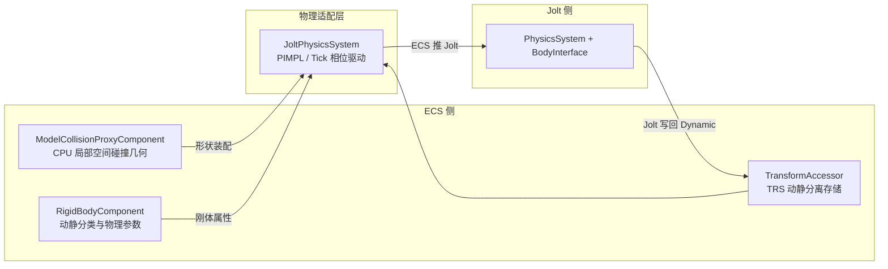

# ULRE × JoltPhysics 集成现状技术文档

> 更新日期：2026-11-08
> 涉及分支：`feature/gpu-model-template`（已快进合入 `hyzboy-jolt-physics-examples`，HEAD `ec4bbd599`）

---

## 1. 总体现状

引擎已完成 **JoltPhysics 物理后端** 与 **ECS 接入层** 的第一阶段对接，具备：

| 能力 | 状态 | 位置 |
|---|---|---|
| Jolt 生命周期管理（分配器/线程池/PhysicsSystem） | ✅ | `src/ecs/systems/tick/JoltPhysicsSystem.cpp` |
| `ModelCollisionProxyComponent` → Jolt 形状自动装配 | ✅ | 同上 `CreateOrUpdateBody` |
| 刚体组件（Static / Kinematic / Dynamic + 物理参数） | ✅ | `inc/hgl/ecs/components/RigidBodyComponent.h` |
| ECS ⇄ Jolt 双向变换同步（Tick 相位） | ✅ | `JoltPhysicsSystem::Update` |
| 射线 / 线段 / 球 / 盒 空间查询 | ✅ | `JoltPhysicsSystem` 查询 API |
| 可复用场景层（范例 1~4，无头可测） | ✅ | `src/ecs/tests/PhysicsScenarios.{h,cpp}` |
| 无头自动化测试 | ✅ | `TestJoltPhysicsIntegration`、`TestPhysicsScenarios`（ctest 2/2 通过） |
| GUI 可视化范例 1~4 | ✅ | `example/Physics/` |
| 碰撞事件/接触回调、休眠唤醒事件、材质摩擦组合表 | ⬜ 未做 | 见 §10 后续工作 |

依赖来源：**vcpkg 安装的 JoltPhysics**，通过 CMake `find_package` 接入（§2）。

---

## 2. 依赖与构建集成

- `src/ecs/CMakeLists.txt`：

  ```cmake
  find_package(Jolt CONFIG REQUIRED)
  target_link_libraries(ULRE.ECS PUBLIC Jolt::Jolt)
  ```

  ULRE.ECS 以 PUBLIC 方式链接，范例与测试目标自动获得 Jolt 头文件与库。
- 测试目标（同文件）：
  - `add_ecs_test(TestJoltPhysicsIntegration tests/TestJoltPhysicsIntegration.cpp LIBS Jolt::Jolt)`
  - `add_ecs_test(TestPhysicsScenarios ...)`（同时编译 `PhysicsScenarios.cpp`）
  - ctest 属性：`LABELS "ecs;physics;jolt"`，`TIMEOUT 60/120`。
- GUI 范例：`example/Physics/CMakeLists.txt` 用统一 `CreateProject` 宏注册 4 个可执行目标，每个目标额外编译 `../../src/ecs/tests/PhysicsScenarios.cpp`（场景层与测试共用同一份实现）。
- 引擎核心不出现 `JPH::` 类型泄漏：`JoltPhysicsSystem.h` 仅前向声明 `JPH::BodyInterface / JPH::PhysicsSystem`，实例由 **PIMPL（`class Impl`）** 持有；对外接口全部使用 `math::Vector3f`、`glm::quat`、`EntityID`、整型编码的 `body_id` 等 HGL/ECS 类型。

---

## 3. 架构与组件划分



### 3.1 ModelCollisionProxyComponent（既有系统，无改动）

- 形状类型：`None` / `Box` / `Capsule`（**轴 = 局部 Z**）/ `ConvexHull`（凸包顶点池 + offset/count 引用）。
- 每个 `ModelCollisionBody` 携带 `local_center`、`half_extents`、`local_rotation`、`radius`、`half_height`、`collision_flags`。
- 与 GPU 零件 / LOD 完全解耦；多个实例共享同一份代理数据；获取入口 `GetModelCollisionProxy(Entity*)`。

### 3.2 RigidBodyComponent（新增）

- `BodyMotionType`：`Static`（固定物，不写回 Transform）/ `Kinematic`（ECS 逻辑驱动、可推挤动态体）/ `Dynamic`（模拟结果写回 Transform）。
- 参数：`mass`、`friction`、`restitution`、`linear_damping`、`angular_damping`、`gravity_factor`、`is_sensor`、`allow_sleeping`。
- 内部管理：`jolt_body_id`（`JPH::BodyID` 的 index+sequence 编码）与 `physics_system` 引用；`OnDetach()` 由组件池销毁行时自动调用，**实体/组件销毁时刚体自动回收**。
- 便捷方法：速度读写、`AddForce/AddImpulse/AddTorque/AddAngularImpulse`、`SetPositionAndRotation`（传送）、激活状态查询。

### 3.3 JoltPhysicsSystem（新增，`hgl::ecs`，Tick 相位系统）

- 生命周期：`Initialize()`（注册 TempAllocator/JobSystem/PhysicsSystem、宽相位层、对象层过滤）/ `Shutdown()` / `Update(deltaTime)`。
- 刚体管理：`CreateOrUpdateBody(Entity*)`、`DestroyBody`、激活控制、速度与力接口、`SetPositionAndRotation`。
- 查询：`Raycast`、`RaycastSegment`、`OverlapSphere`、`OverlapBox`（结果结构 `PhysicsRaycastHit` / `PhysicsOverlapHit`，直接回带 `Entity*`）。
- 底层逃生门：`GetJoltPhysicsSystem()` / `GetJoltBodyInterface()`。
- 重力：默认 `(0, 0, -9.81)`，`SetGravity/GetGravity` 可调。

---

## 4. 坐标系与形状映射约定

引擎约定：**Vulkan、右手系、世界 Z-up（X 右、Y 前、Z 上）**。Jolt 惯例为 Y-up、胶囊沿 Y 轴。对接规则：

1. **向量与位置**：`math::Vector3f ⇄ JPH::Vec3` 逐分量直传（`ToJPH`/`FromJPH`），不做轴交换——Jolt 内部与轴选择无关，重力写成 `(0,0,-9.81)` 即等效 Z-up。
2. **旋转**：`local_rotation` 是 **欧拉弧度 Vector3f（XYZ 序）** 而非四元数；装配时用 `JPH::Quat::sEulerAngles` 解释。写回 ECS 时经 `glm::quat` 中转。
3. **胶囊轴向**：ULRE 胶囊轴 = 局部 Z，Jolt `CapsuleShape` 原生沿 Y。装配时先做 `align_z = sRotation(X, +90 度)` 把 Y 轴映射到 +Z，再复合 `local_rotation`：`rot = sEulerAngles(local_rotation) * align_z`。
4. **Box**：`half_extents` 直传 `BoxShapeSettings`。
5. **ConvexHull**：从代理顶点池拷贝 `hull_vertex_count` 个顶点构造 `ConvexHullShapeSettings`（当前不做额外旋转）。
6. **多 body 组合**：代理内所有 body 统一装配进一个 `StaticCompoundShapeSettings`，保持各子形状的 `local_center/local_rotation`。
7. **None / 空代理**：跳过，不创建刚体。

---

## 5. 物理层与过滤

- ObjectLayer：`NON_MOVING=0`、`MOVING=1`、`SENSOR=2`；BroadPhaseLayer 一一对应（3 层）。
- `ObjectLayerPairFilter` 规则要点：
  - 静态 ↔ 静态 不碰撞；
  - **SENSOR 层不与任何东西产生物理阻挡**（仅用于重叠查询）；
  - MOVING/NON_MOVING 正常互撞。
- 传感器：`RigidBodyComponent::is_sensor = true` → `mIsSensor` + SENSOR 层。
- 运动学归类：Kinematic/Dynamic → `MOVING` 层，Static → `NON_MOVING` 层。

---

## 6. 双向同步流程（每帧 Tick）

`JoltPhysicsSystem::Update(delta)` 在 ECS `ExecutionPhase::TickPhysics` 相位执行，顺序固定：

```
1) ECS -> Jolt：
   - Kinematic 刚体：读取 TransformAccessor 世界 TRS -> BodyInterface::MoveKinematic
     （速度由逻辑位移差推导，可推挤动态体）
   - Dynamic 刚体被外部瞬移（Transform 脏标记 / 手动 SetPositionAndRotation）-> SetPositionAndRotation
2) Jolt 步进：PhysicsSystem::Update(delta, ...)（含宽相位/窄相位/求解器）
3) Jolt -> ECS：
   - 仅 Dynamic 刚体：模拟结果 position/rotation 写回 TransformAccessor（SetWorldTRS），
     随后由 TransformSystem 传播到子实体
```

时序约定：**GUI 每帧 `WorkObject::Tick(delta)` 内部驱动全部 ECS 系统（含物理）**；若逻辑需要「本帧位移下帧生效」，应在基类 `Tick` **之前** 写 Kinematic 目标位姿（范例 03 即此模式）。

### 6.1 自动创建规则（免配置路径）

`CreateOrUpdateBody(entity)`：

- 必须存在 `ModelCollisionProxyComponent` 且 `HasCollision()`，否则返回无效 id；
- 若实体未挂 `RigidBodyComponent`，自动补挂并按 **Transform 动静特性** 推断：
  - `TransformAccessor.IsMovable()` -> `Kinematic`
  - 否则 -> `Static`
- 已有旧刚体时先 `DestroyBody` 再重建（形状变更可热更新）。

---

## 7. 查询 API

| API | 说明 |
|---|---|
| `Raycast(origin, dir, max_dist, out)` | 归一化方向射线；命中返回实体、位置、法线、distance/fraction/body_id |
| `RaycastSegment(start, end, out)` | 两点线段 |
| `OverlapSphere(center, r, out_hits)` | 球域重叠（含传感器体积） |
| `OverlapBox(center, half, rot, out_hits)` | 有向盒重叠 |

命中结果均携带 `Entity*`，业务层无需维护 Jolt BodyID -> 实体的反查表（适配层内部已映射）。

---

## 8. 场景层 PhysicsScenarios（双轨设计）

`src/ecs/tests/PhysicsScenarios.{h,cpp}` 是范例 1~4 的**纯 ECS 场景搭建层**，零渲染依赖，同一份代码服务两侧：

- 无头测试 `TestPhysicsScenarios`：`StepPhysics()` 固定步长推进 + 数值断言（CI 可跑）；
- GUI 范例：在返回的实体指针上挂渲染组件（`PhysicsVisualKit`）。

通用工厂：`CreatePhysicsBox / CreatePhysicsCapsule / CreatePhysicsCompoundBoxEntity`（参数 `PhysicsBodyDesc` 映射到 `RigidBodyComponent` 字段）。

---

## 9. 四个范例的实现说明

GUI 公共支撑：`example/Physics/PhysicsAppCommon.h`（header-only `PhysicsVisualKit`）——复用 `RenderBoundBox.Solid/Wire` 材质配方、内建 `cube/capsule/bounding_box` 几何、16 色语义色环（`PhysicsRow`）、按实体 MaterialData 行上色、逐帧从 `TransformAccessor` 同步视觉实体 TRS。形状映射：Box -> 单位盒非均匀缩放；Capsule -> 内建胶囊 (r0.5/hh1.0) 按 `(2r, 2r, (hh+r)/1.5)` 缩放 + 欧拉 `local_rotation` 转 quat；ConvexHull -> 用 `scale=2*radius` 盒近似；`None` 跳过。线框统一用包围盒 12 棱示意。

### 范例 01：箱体堆叠与弹性落箱（`01_BoxStacking.cpp`）

- **演示点**：静摩擦金字塔堆叠（3-2-1 共 6 箱）、高恢复系数落箱反弹、Dynamic 结果写回渲染。
- **场景**：静态地面（顶面 z=0）+ 金字塔箱（半高 0.5 层叠 z=0.5/1.5/2.5）+ 两枚 `restitution` 约 0.8 落箱自 z=8/12 释放。
- **交互**：`空格`（边沿触发）动态投放一枚新箱（mass 2、restitution 0.8、`allow_sleeping=false`，黄色高亮）。
- **验证（无头）**：步进后金字塔箱体保持原位、落箱最终静止高度落在预期层位、能量单调收敛。

### 范例 02：Z-up 胶囊与复合体斜坡（`02_CapsuleCompound.cpp`）

- **演示点**：胶囊轴局部 Z 与 Jolt Y 轴映射、绕 X 轴 -20 度斜坡、复合形状（多 Box 组合的「小车」）。
- **场景**：静态地面 + 斜坡（法线 n=(0,-sin t,cos t)，t=20 度）+ 坡顶胶囊（局部 Z 对齐 n）+ 复合小车。
- **交互**：`空格` 在坡顶带 ±0.3 随机抖动投放新胶囊；下滑方向 (0,cos t,sin t)（+Y 侧低端）。
- **验证**：步进后胶囊/小车 `world_y` 沿 +Y 移动、`world_z` 下降，与解析斜面加速度方向一致。
- **踩坑记录**：早期把 `angleAxis` 符号写反导致胶囊穿进坡体；`glm::radians` 非 constexpr，不能用于 `constexpr` 变量初始化。

### 范例 03：运动学平台推挤（`03_KinematicPlatform.cpp`）

- **演示点**：Kinematic 刚体的 **ECS->Jolt 单向驱动**（`MoveKinematic`），平台正弦往复推挤动态箱体撞向挡墙。
- **场景**：地面 + Kinematic 平台（起始 (0,0,0.75)，沿 Y 正弦往复，幅度 4）+ 平台上的 Dynamic 箱子若干 + 静态挡墙。
- **驱动时序**：每帧 `sim_time_ += delta` -> **先** `DriveKinematicPlatform(ctx, sc, sim_time_)` 写平台 TRS -> **后** `WorkObject::Tick(delta)`（物理系统在该 Tick 内读取新位姿）。顺序颠倒会让平台「永远慢一帧」。
- **验证**：无头测试每步内先 Drive 再 Update；断言 riders 的 y 坐标随平台包络被推动、最终被挡墙拦截收敛。

### 范例 04：射线击飞与传感器区域（`04_RaycastSensor.cpp`）

- **演示点**：`Raycast` 命中 -> `AddImpulse` 击飞；`is_sensor` 体积 + `OverlapBox` 区域感应高亮。
- **场景**：地面 + 传感器盒（center (6,0,1.5)、half (1.5,1.5,1.5)，青色线框，SENSOR 层不阻挡）+ 散落动态箱（其中一枚初始位于传感器内）。
- **交互**：
  - `鼠标左键`（边沿）：相机到屏幕点解算射线 -> `PickRay` -> `RaycastAndKnockback(..., dir*40 + (0,0,12))`，命中实体变红；
  - 每帧 `QuerySensorOverlap` 与上一帧集合比较，区内实体高亮、出区恢复白色。
- **验证**：无头断言 `RaycastAndKnockback` 返回目标实体且其速度突增；`QuerySensorOverlap` 初始命中 `in_sensor_box`，冲量将其打出后集合不再包含。

---

## 10. 已知限制与后续工作

1. **无接触/碰撞回调**：当前只有查询式（OverlapBox 轮询）传感，未接 Jolt 的 `ContactListener` / 碰撞事件队列；做「受击伤害、拾取触发」前需要补事件层。
2. **ConvexHull 视觉近似**：范例里凸包用外接盒示意，未做 hull 网格可视化。
3. **胶囊线框**：统一用 bbox 12 棱示意，非真实胶囊轮廓。
4. **物理材质组合**：`friction/restitution` 直接取组件字段（Jolt 默认 CombinePolicy），未接引擎材质-表面摩擦表。
5. **Transform 缩放**：刚体装配不读取世界缩放（代理几何视为真实尺寸）；带缩放实例需烘进代理。
6. **休眠事件、角色控制器 / 车辆约束（VehicleConstraint）** 未对接。
7. 步进为帧率跟随（`delta` 直传），可考虑固定步长 + 插值。

---

## 11. 快速上手

```cpp
// 1. 注册并初始化物理系统
auto physics = ctx.RegisterSystem<hgl::ecs::JoltPhysicsSystem>();
physics->Initialize();

// 2. 用场景层搭世界（或直接给实体挂代理 + 刚体组件）
auto sc = hgl::ecs::BuildBoxStackingScenario(&ctx);

// 3. 每帧由 ECS Tick 自动驱动；查询示例：
hgl::ecs::PhysicsRaycastHit hit;
if (physics->Raycast(origin, dir, 100.0f, hit) && hit.entity)
    physics->AddImpulse(hit.body_id, dir * 40.0f);
```

构建与运行（Windows / Debug）：

```powershell
cmake -B build -S .
cmake --build build --target Physics01BoxStacking --config Debug   # 02/03/04 同理
ctest --test-dir build -C Debug -R "TestJolt|TestPhysicsScenarios" --output-on-failure
```

范例可执行文件输出在 `build\out\Windows_64_Debug\`。

---

## 12. 相关提交

| 提交 | 内容 |
|---|---|
| `9f85fadda` | feat(ecs/physics): JoltPhysicsSystem + RigidBodyComponent + 代理自动装配 |
| `c2baef842` | feat(ecs): 范例 1~4 可复用场景层 PhysicsScenarios |
| `287409b30` | test(ecs): 场景 1~4 无头断言测试 |
| `ccf6fc1fc` | feat(example): PhysicsVisualKit 视觉套件 |
| `ec4bbd599` | feat(example): GUI 范例 01~04 + CMake 接入 |