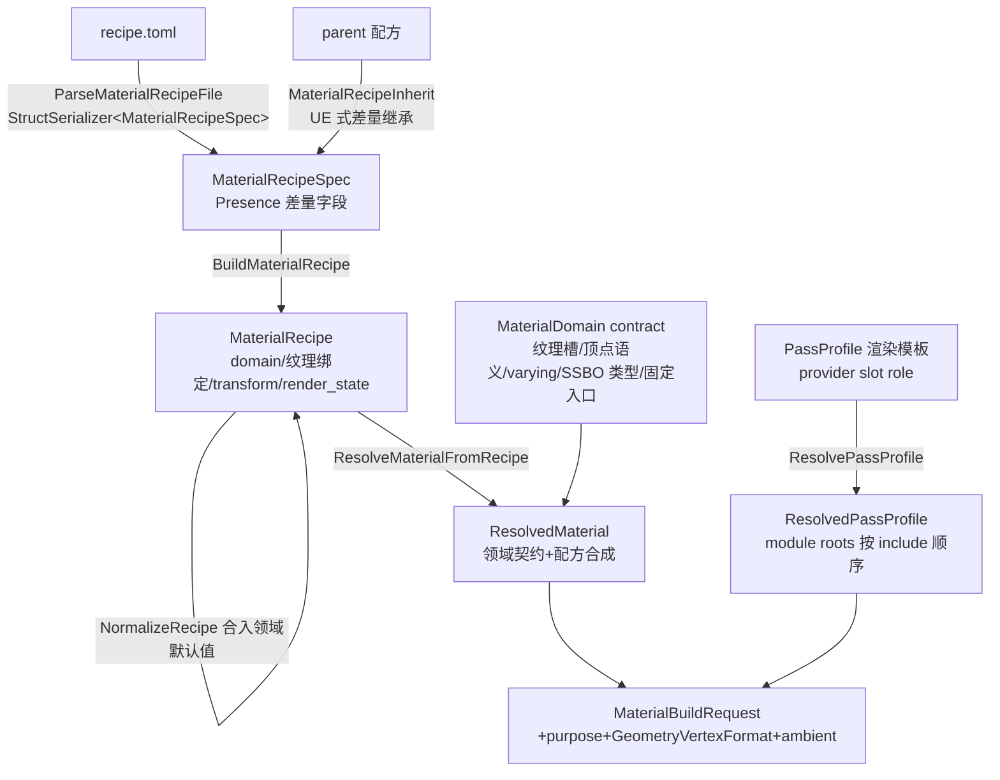

# ULRE 材质/GLSL 系统整体工作流分析

> 基于 CMake 工程与以下目录的代码走读生成（2026-11）：
> `ShaderLibrary/`、`inc/hgl/mtl/`、`inc/hgl/shader/`、`src/ShaderCompiler/`、
> `src/ShaderMaterialData/`、`src/ShaderProgramBuild/`、`src/ShaderRuntimeContract/`。
> 相关既有文档：`material-domain-contract-architecture.md`、
> `shadergen-elimination-domain-fixed-architecture.md`、`build-and-module-structure-audit-2026-10.md`。

## 一、CMake 模块分层（依赖方向自下而上）

`src/CMakeLists.txt` 与根 `CMakeLists.txt`（约 70-125 行）定义了 4 层架构，核心设计目标是
**让运行时可以完全不链接着色器生成器**：

| 模块 | 位置 | 职责 | 发行形态(OFF)仍构建 |
|---|---|---|---|
| **ULRE.ShaderRuntimeContract** | `src/ShaderRuntimeContract` | 纯数据契约：`ShaderProgramKey/StageKey`、`ShaderLinkSpec`、`ShaderArtifactContract`、设备 profile、SPVData。硬约束：零 GLSL 处理、零 IO、零编译器符号（`ShaderRuntimeContract.cpp` 是编译期哨兵） | ✅ |
| **ULRE.ShaderMaterialData** | `src/ShaderMaterialData` + `inc/hgl/mtl` | 数据面：TOML 配方解析/继承、领域契约校验、Resolver、GlslModule 注册表、PassProfile、`frag_options.glsl` 发射、SPV 产物库、manifest 后端、MaterialDataBlock | ✅ |
| **ULRE.ShaderCompiler** | `src/ShaderCompiler` | glslang 插件桥：GLSL→SPIR-V 编译 + 反射（`GetSPVPushConstantEnd`），运行时（SceneGraph）也要用，加载 `GLSLCompiler.dll`（插件源码在 `src/Tools/GLSLCompiler`） | ✅ |
| **ULRE.ShaderProgramBuild** | `src/ShaderProgramBuild`（builder/compile/contract/template） | 生成面：材质→程序构建计划、GLSL 拼装、阶段编译编排、契约校验、Domain 后端 | ❌ 仅 ON |

关键机制：

- `ULRE_ENABLE_SHADER_PROGRAM_BUILD=OFF` 时全工程统一下发宏 `=0`（不按配置区分），
  只保留读预烘焙 SPV 的运行时；聚合入口收敛为 `ULRE::Runtime`（发行唯一入口）与
  `ULRE::Engine`（开发机工具/示例）。
- ON 时 `ULRE.ShaderProgramBuild` 必须 **WHOLE_ARCHIVE** 链接——其生命周期注册 TU
  （`compile/ShaderBuildBackendLifecycle.cpp` 的 TU 级静态对象在启动时调
  `SetShaderCompilerLifecycleHooks`）没有任何对外符号，普通静态链接会被链接器整 TU 丢弃，
  导致后端槽为空、材质构建错误退化到 manifest 后端（根 CMake 注释含 SimpleSphere.exe 实证）。
- 模块间通过**后端槽接缝**解耦：`ShaderProgramBuildBackend`（`CreateBuildContext` /
  `FinalizeBuildContext`），两套实现先到先得、后装不覆盖——开发树由 compiler 就绪钩子装
  **DomainShaderBuildBackend**，发行形态由 `EnsureShaderProgramManifestBackend()` 装
  **manifest 后端**。
- 依赖注释明确：`ShaderRuntimeContract` 必须先于 `ShaderProgramBuild`；
  `ULRE.Vulkan / ShaderProgramBuild / SceneGraph / ECS` 构成强连通分量，故只做聚合等价链接、
  不拆逐模块依赖（见 `build-and-module-structure-audit-2026-10.md`）。

## 二、数据面：TOML → ResolvedMaterial



### 2.1 文件层与继承

- `MaterialRecipeSpec`（`inc/hgl/graph/asset/MaterialRecipeSpec.h:44-255`）是 TOML 的纯数据映射：
  `schema/name/parent/domain`、`[fragment]`（surface_module_name、samplers、defines）、
  `[transform]`（source/mapping/orientation/scale/projection）、`[render_state]`
  （alpha_test/cutoff/dither + `[render_state.pipeline]` 11 个逐字段覆盖）、
  `[[textures]]`（name/asset/required/layer/auto_mipmaps）。
- **没有独立 passes / 通用 parameters 表**。Pass 由场景模板、`ShaderProgramPurpose`、领域能力
  与环境 provider 路由得到；材质参数分三类：编译期（samplers/defines/transform/render state）、
  运行期（`material_ssbo_binding` + `MaterialDataBlock`）、纹理资源绑定（`[[textures]]`）。
- 继承为 UE Material Instance 式差量：子配方只写变化项，`Presence<T>` 未 present 的字段从父继承；
  纹理以名字为合并键（子项可只改 asset 不丢 required/layer/auto_mipmaps）
  （`MaterialRecipeInherit.cpp`、`MaterialRecipeFile.h:41-60`）。
- 解析走 `hgl::serialize` 统一通路（`StructSerializer<MaterialRecipeSpec>`，字段名/枚举由
  AssetGen 产物统一定义，`MaterialRecipeFile.cpp:111-142`）。

### 2.2 领域契约与 Resolver

- `MaterialDomain` 是 Fixed-Code Domain Shader 的**封闭契约**：顶点语义 requirements、
  允许/必须的纹理槽及语义角色、sampler 类型与 channels、顶点提供策略、material SSBO 类型、
  varying/coverage、默认 render state、固定 shader entry、规范 surface/module
  （`MaterialDomain.h:14-106,150-180`、`MaterialDomain.cpp` 契约表）。
- 领域只描述"表面"，不描述光照/GI/天光/shadow/pass 输出（`MaterialDomain.h:45-49`）。
- `ResolveMaterialFromRecipe` 是唯一解析入口（`MaterialResolver.h:188-197`），产出
  `ResolvedMaterial`（领域纹理声明、SSBO 类型、顶点/语义/varying 要求、sampler、defines、
  render state、coverage 等）。配方显式声明 `sampler_names`/`compile_defines` 则**整表替换**领域默认。
- `NormalizeRecipe` 是进入渲染路径前的强制步骤：合入契约默认值、构造 fallback、把 render state
  override 回写为完整权威值（此后 `has_*` 必须全为 true），且幂等（`MaterialResolver.h:238-256`）。
- 解析器明确拒绝：`Custom` 无契约领域；有 contract 但无固定入口 `.frag` 的领域
  （如未实现入口的 Foliage/Terrain/UI2D/HumanSkin）（`MaterialRecipeFile.cpp:103-141`）。

### 2.3 PassProfile（渲染模板）

- `PassProfileRequest` = profile ID + stage + version + **按固定 role 排列的 module roots**
  （Surface/Diffuse/Specular/Shadow/Ambient/AO/LightingModel/OutputPolicy/
  MaterialSource/NTB/Sky 等，`PassProfile.h:10-96`）。
- **slot 数组顺序 = GLSL include 顺序**，重排会改变最终文本、program hash 与 SPV 缓存身份；
  `SurfaceProvider` 必须排在 `MaterialSourceProvider`/`NTBProvider` 之后
  （`PassProfile.h:108-130`）。
- `ScenePassProfileResolver` 结合材质能力、purpose、场景模板、ambient、depth/shadow 得出最终请求；
  校验含 role 不重不缺、module 存在且 slot role 匹配、capability 闭合、依赖无环
  （`ScenePassProfileResolver.cpp`、`PassProfile.h:130-167`、`template/PassProfileResolve.cpp:147-197`）。

### 2.4 GlslModule 注册表与资源闭包

- `ShaderLibrary/module/**` 每个 GLSL 文件经源码内 `@ulre slot / @ulre require / @ulre uses`
  注释注册为 `GlslModuleDefinition`（`GlslModule.h:200-249`、`GlslModuleFile.cpp`、
  `GlslModuleMetadata.cpp`）。**模块身份只有名字**（FNV1a(name)），无 numeric ID 轨道
  （`GlslModule.h:10-20`）；`@ulre uses` 是依赖唯一真源。
- `ShaderCodeResourceManifest` 从 profile roots 递归遍历模块图，产出有序模块闭包 +
  纹理/采样器引用 + 稳定哈希；检测未知模块、环、资源冲突、容量溢出
  （`ShaderCodeResourceManifest.cpp:114-252`）。

## 三、GLSL 资产组织（ShaderLibrary）—— Fixed-Code Domain 范式

已**废除按材质组合生成整段着色器**的 ShaderGen 路线，改为：

- `domain/<domain>/*.frag` —— 有限的**固定主着色器**（`standard_opaque/forward_lit.frag`、
  `shadow_caster(.masked).frag` 等），同一 domain/pass 只有一个物理文件；MaterialRecipe
  不再改变主 shader 文本（`forward_lit.frag:1-13` 注释明示）。
- 主着色器唯一可变输入是 `#include "generated/frag_options.glsl"`（十几行宏表，
  **兼作 program 身份**）。`DomainOptionsInput` 携带 profile（ForwardLit/ForwardUnlit/
  ShadowCaster/None）、纹理投影、ambient include、shadow PCF、alpha test/cutoff/dither 等；
  硬约束：只发射 ShaderLibrary 实际消费的宏、float 文本逐字节稳定、channels==0 的槽完全不发射、
  ForwardLit 必须有 ambient include、ambient/投影以字面 `#include` 出现
  （`DomainOptions.h:1-39,170-215`、`DomainOptionsEmitter.cpp`）。
- `generated/common_options.glsl` —— mesh/fragment **共用**的跨阶段 varying 宏开关源
  （`HGL_VARYING_*`，由 `InterStageVaryingOptions` 从 `ShaderSemanticRegistry` 派生），
  `module/stage/interstage_varying.glsl` 据此两侧对称声明/读写
  （`contract/InterStageVaryingOptions.cpp:64+`、`DomainShaderBuildBackend.cpp:394-410`）。
- `module/interface/*` —— provider 必须实现的函数契约（`EvalSurface`、`EvalDiffuseLight`、
  `EvalSpecularLight`、`EvalMaterialSource`、`EvalMaterialAlpha` 等）；
  `module/provider/*` 按 slot 分类（lighting_model、material_source、ambient_light、
  diffuse/specular、shadow、ntb、output_policy、surface、sky），选择体现为 include 而非运行时分支。
- `module/vertex/*` —— 可组合顶点节点：`stream_*`（属性装载）+ `transform_*`
  （如 `transform_world_camera_vp.glsl` 实现 GetWorldPos/GetWorldNormal/GetClipPos）+ helpers。
- `module/descriptor/*` —— UBO/SSBO/bindless 声明；`ssbo/material_data_row.glsl` 为 codegen
  产物（`MaterialDataRow`：surface_type / surface_ssbo_id / surface_data_index / authored_flags）。
- `module/stage/stage_body.glsl` —— 固定 mesh stage 主体，include 前需备齐 topology 字面量、
  varying、`generated/mesh_options.glsl`、`ULRE_MESH_MAX_VERTS/INVOCATIONS`
  （`stage_body.glsl:1-30`）。
- `topology/*.mesh` —— mesh shader 固定主体（tri_192 / linequad_256 / charquad_256；
  **VS 已废弃**，graphics program 仅 Mesh + Fragment 两级 stage）。
- `contract/` —— `descriptor_macros.glsl`（bindless set 0 + BDA push constant 访问）、
  `engine_constants.glsl`、`interstage_locations.glsl`、`sampler_presets.glsl`（+ `sampler.toml` 源）。
- `asset/` —— `recipe/*.recipe.toml`、`material_data/*.material_data.toml`、
  `texarray/*.texarray.toml`、`environment/*.env(.toml)`（环境资产：ambient mode、
  irradiance/prefilter URI、SH9 自动生成等）。

## 四、构建面：材质 → SPIR-V

### 4.1 程序组装（builder/）

`AssembleMaterialProgram`（`builder/MaterialProgramAssembler.cpp`）分阶段：

1. **Purpose/Coverage**：构造 `MaterialCoverageContract` → `ResolvePassProfile`；
   DepthOnly/ShadowDepth 强制 ShadowCasterOpaque/Masked profile（`:124-206`）。
2. **跨阶段接口**：`BuildMaterialStageInterface` 由 vertex varying 配置生成语义 entry 列表，
   `ShaderSemanticRegistry` 校验顺序/名称/类型/location（`:212-240`）。
3. **顶点 ABI**：`ResolveVertexABI` + `VertexABIBuilder.cpp` 按 stream/`VkFormat`/语义发射
   GLSL 输入声明及 ABI 哈希；CharQuad 例外（mesh 自声明 SSBO）（`:246-291`）。
4. **Mesh 模式**：Tri/LineQuad/CharQuad + topology 容量决定固定主文件（`:292-350,467-495`）。
5. **资源/provider/output 契约**：provider、纹理、采样器、resource manifest 纳入
   compile/link identity；`CanonicalShaderContract` 校验输出契约（purpose 合法性、
   DepthOnly 不允许 attachment、semantic/location 冲突、canonical 序列化哈希，
   `contract/CanonicalShaderContract.cpp:21-74,104-150`）。
6. **身份计算**：
   - `ShaderStageKey` = FNV1a(stage, definition_hash〔主 shader 文本〕,
     compile_inputs_hash〔include 闭包/defines/options/资源模板契约〕,
     interface_hash〔varying/输出附件/domain/purpose/coverage〕,
     compiler_hash〔Vulkan/SPIR-V 目标版本 + 设备 profile〕)，
     文件名 `stage-<stage>-<digest>`（`ShaderStageKey.h:34-58`、assembler `:1169-1235`）。
   - `ShaderProgramKey` = mesh stage digest + frag stage digest + link_contract_hash
     （资源布局身份/输出契约/RT 形状），由 `ShaderLinkSpec::BuildKey()` 组合
     （`ShaderProgramKey.h:22-40`、`:1238-1250`）。

### 4.2 阶段编译与插件桥（compile/ + src/ShaderCompiler）

`FinalizeShaderBuildContext`（`compile/StageSPVCompiler.cpp:140-270`）：

1. 按 stage key 从 `ShaderArtifactStore` 读缓存 SPV → 填 `ShaderCreateInfo::cached_spv_data`；
2. miss 时 `CreateShaderDirect()` 经 `ShaderCompilerAPI`（`inc/hgl/ShaderCompilerAPI.h`：
   Init/Close/Compile/ReflectSPVData/GetSPVPushConstantEnd/include root/设备 profile/生命周期钩子）
   调用 `GLSLCompiler.dll` 插件（glslang；`src/ShaderCompiler/GLSLCompiler.cpp:220-329,612-666`，
   ABI version 2，插件注册表在 `src/Tools/GLSLCompiler/glsl2spv.cpp:1010-1073`）；
3. 至少一个 stage 新编译时做**双 stage SPIR-V 接口反射校验**；
4. 新 SPV、program metadata、最终 GLSL 写回 artifact store；支持 ReadOnly 模式（缺缓存即失败）。

反射数据面：插件输出 **Shader Flat v3** 格式（`src/Tools/GLSLCompiler/SPVParseFlat.h`，
flat 文件格式单一真源在插件侧；v3 将 set/binding/array_size 扩为 uint16 防 bindless 回绕）；
`src/ShaderCompiler/ShaderReflectionData.cpp:33-105` 的 `Extract/FindDescriptor/GetPushConstantEnd`
转成引擎反射数据，供 Vulkan 层建 pipeline layout。

### 4.3 DomainShaderBuildBackend（实际生效的开发后端）

`compile/DomainShaderBuildBackend.cpp`：

- 仍调 `AssembleMaterialProgram` 取 mesh 组装、stage key、link spec、metadata；
- **fragment 不生成主 shader**：改为选 `ShaderLibrary/domain/<domain>/<master>.frag`
  + 注入 options/include root；
- 发射并落盘 `generated/{frag,mesh,common}_options.glsl`，按内容键缓存于
  `<ShaderCacheRoot>/domain-options/<content-key>/generated/`（`:422-510`）；
- mesh 阶段完整走普通 stage assembly（复用网格阶段是其留在 ShaderProgramBuild 的原因，
  见该模块 CMake 注释）。

生命周期：~~`compile/ShaderBuildBackendLifecycle.cpp:1-45` 静态对象在 compiler ready 时~~
（阶段 2 已改为 AppFramework 在 `InitShaderCompiler()` 成功后显式调用
`mtl::InstallDomainShaderBuildBackend()`，钩子层与 WHOLE_ARCHIVE 已删除）
`InstallDomainShaderBuildBackend`、close 时卸载；安装入口在
`compile/ShaderProgramBuildBackendInstall.h`。

### 4.4 缓存布局

- 缓存根：`inc/hgl/mtl/ShaderCacheRoot.h`；子目录 `shader-cache`，SPV 扩展名 `.spv`
  （`ShaderArtifactContract.h:15-22`）；
- `ShaderArtifactStore`：stage key → `.mesh/.frag` SPV + 源摘要；
  program key → program link + artifact metadata（`ShaderArtifactStore.h:15-75`）；
- debug GLSL dump：`<ShaderCacheRoot>/glsldump`（`StageSPVCompiler.cpp:188-197`）。

## 五、运行时消费（SceneGraph / Vulkan / Work）

入口 `ShaderProgramManager::AcquireShaderProgram(const mtl::MaterialBuildRequest&)`
（`src/SceneGraph/module/ShaderProgramManager.cpp:694-850`）：

1. `NormalizeRecipe` → `ResolveBuildRequest`（MaterialResolver）→ 计算 variant manifest key；
2. 查内存 variant cache；miss 则取 `ShaderProgramBuildBackend`（必要时装 manifest 后端）→
   `CreateBuildContext`；
3. 按 `ShaderProgramKey`（`ctx.GetProgramLink().BuildKey()`）查 program-link 缓存——
   相同 link 内容的多个配方变体共享同一 program；
4. `FinalizeBuildContext`（查/编译/校验 SPV）→ 建 Vulkan shader program → 写 manifest/cache。

两级 key：**variant key**（resolved material + build request + 物理设备 profile）区分配方变体；
**ShaderProgramKey** 识别实际 program link 内容。后端缺失时**报错而非静默降级**。

Vulkan 层不持有 MaterialResolver/后端实现；`VKComputePipeline.cpp:11` 注明共享 global layout
由 ShaderProgramManager 持有。

**逐实例材质数据**走独立链：

```
material_data.toml / MDB1 二进制
  → MaterialDataBlock（type + row_bytes + row_count + rows；拥有型与零拷贝 view 同路径）
  → MaterialDataBlockRegistry::UploadAll（:353-373）
  → GlobalSSBOBufferRegistry::UploadMaterialDataBlock（:365-411）
  → shader 经 MaterialDataRow 的 surface_ssbo_id + surface_data_index，
    以 MTL_ROW(i) / MTL_TEX(i) BDA 寻址取 PBR 行
```

`GetRowBinding()` 按 URI/name 找 asset、确保整块上传、返回行 SSBO binding
（`MaterialDataBlockRegistry.cpp:424-465`）。纹理槽顺序（base_color, roughness, metallic,
occlusion, opacity_mask, normal）是**物理 ABI**，`standard_opaque_bindings.glsl:1-31` 与
`MaterialDomain.cpp` 契约表必须同步，否则整表错位。

示例链（`example/Material/BasicLitMeshes.cpp:35-60`）：scene.toml → SceneAsset::Instantiate →
引用 MaterialRecipe/material data → ShaderProgramManager 解析取 program。

## 六、两种形态对照

| | 开发形态（ON） | 发行形态（OFF） |
|---|---|---|
| 后端 | DomainShaderBuildBackend（compiler 生命周期钩子装入） | ManifestBackend（`program_manifest.pmf` 查预烘焙 SPV，`ShaderProgramManifestBackend.cpp:132-230`） |
| GLSL 发射/编译 | 完整 | 无（零 glslang、零发射） |
| 仍保留 | — | 配方解析/继承/normalize/resolve、profile 校验、program/manifest key 计算 |
| miss 行为 | 编译并回填 artifact | **硬失败，绝不静默回退**（`ShaderProgramManifestBackend.h:5-12`） |
| ShaderCreateInfo | 可用 spv_data + releaser | 只许 `cached_spv_data`（`ShaderCreateInfo.h:18-30`） |

`ShaderProgramManifestKey` 特意设计为 OFF 形态仍可独立计算查找 key：吸收 domain/recipe 身份、
purpose、primitive type、几何顶点格式、材质变体、ambient（仅前向光照——shadow/depth 不吸收，
避免无谓分裂变体）、options 文本等价语义、compiler/profile/codegen 戳
（`ShaderProgramManifestKey.cpp:1-65`）。compute 程序另有
`ShaderComputeProgramManifest`。

## 七、关键不变量清单

1. **配方声明"表面"，模板/环境声明"光照"**——两层正交；recipe 不写光照算法。
2. **领域是封闭契约不是建议**：新形态应新增 domain + 固定 shader entry，不放宽已有 domain
   （`MaterialDomain.h:37-57`）。
3. **fragment 主 shader 是有限固定文件**，可变性全部收敛到 `frag_options.glsl`；
   宏集合、数字格式、include 顺序、空行规则都影响 program 身份与缓存等价性。
4. **slot 顺序 = include 顺序 = 哈希输入**，不可随意重排。
5. **模块身份只有名字**；依赖唯一真源是 `@ulre uses`。
6. **运行时→生成器唯一接缝**是 `ShaderProgramBuildBackend` 槽 + ShaderCompiler 生命周期钩子；
   运行时 TU 不得引用 ShaderProgramBuild 符号（否则发行形态链接失败）。
7. **WHOLE_ARCHIVE 是开发形态后端注册的生存前提**。
8. **未 Normalize 的配方不得进入渲染路径**。
9. **manifest miss 必须失败**；发行形态没有 compiler，不允许"凑一份"。
10. **纹理槽顺序是物理 ABI**，GLSL binding 文件与 C++ 契约表必须同步。
