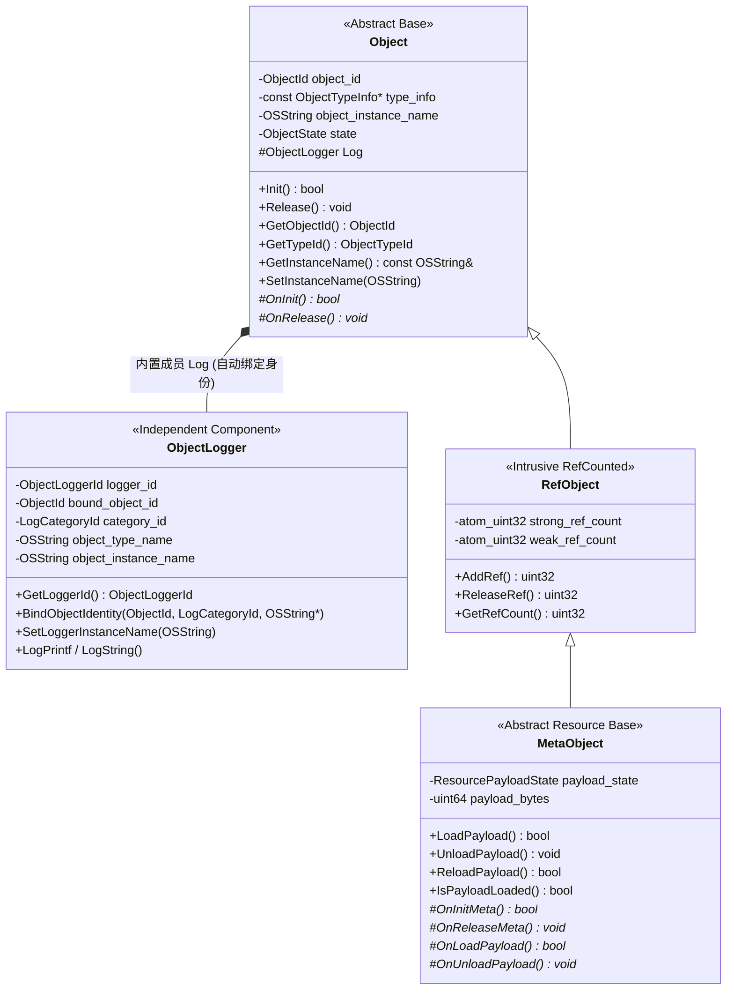
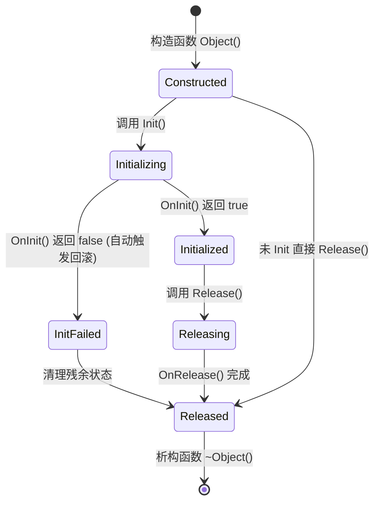

# HGL 对象体系（Object / MetaObject）与 ObjectLogger 协同架构设计方案

> **状态**：设计方案（Draft）  
> **日期**：2026-10-26  
> **范围**：`CMCore`（对象基础体系、日志系统）与 `ULRE`（引擎对象、资源管理、ECS 系统）

---

## 1. 背景与现状痛点

### 1.1 历史遗留物盘点
当前仓库中存在多套未完成或职责重叠的对象基类与追踪设施：

| 现有设施 | 所在位置 | 现状与主要问题 |
|---|---|---|
| `hgl::Object` | `CMCore/inc/hgl/object/Object.h` | 空壳基类（仅有 `NO_COPY`/`NO_MOVE` 与默认构造/虚析构），无身份、无生命周期管理。 |
| `hgl::utils::ObjectBase` | `CMCore/inc/hgl/object/ObjectBase.h` | **已删除**。曾为半成品：大量使用被规范禁止的 STL（`std::string`、`std::mutex`、`std::unordered_map`、`printf`），且反向依赖了上层引擎的 `<hgl/core/ObjectType.h>`（破坏 CMCore 底层独立性）。 |
| `hgl::utils::ObjectTracker` | `CMCore/inc/hgl/object/ObjectTracker.h` | **已删除**。曾预分配百万级大数组导致启动缓慢、干扰 RenderDoc，默认被 `#define HGL_ENABLE_OBJECT_TRACKER 0` 关闭。 |
| `hgl::ecs::Object` | `ULRE/inc/hgl/ecs/core/Object.h` | ECS 自建的基类，仅保存 `AnsiString objectName`，与 `CMCore` 的 `hgl::Object` 割裂。 |
| `hgl::logger::ObjectLogger` | `CMCore/inc/hgl/log/Log.h` | 独立日志组件，用 `object_instance_name` 兼任实例标识与可读名称，缺少稳定的唯一实例 ID 与生命周期事件联动。 |

### 1.2 核心设计目标
1. **`ObjectLogger` 保持独立**：`ObjectLogger` 继续作为独立的轻量日志器存在，既可用于非 `Object` 派生类（普通 `class`/`struct`）、全局（`GlobalLogger`）、模块（`DEFINE_LOGGER_MODULE`），也可嵌入或绑定到 `hgl::Object` 派生类。
2. **统一根基类 `hgl::Object`**：仿照 UE `UObject` 的设计思想，在 `CMCore` 中提供统一的 `hgl::Object` 基类，内置 **类型 ID（`ObjectTypeId`）**、**全局唯一实例 ID（`ObjectId`）**、**人类可读实例名（`object_instance_name`）**。
3. **强制生命周期协议**：通过 NVI（Non-Virtual Interface）模式强制 `Object` 派生类实现明确的初始化（`OnInit`）与释放（`OnRelease`）函数，杜绝资源释放依赖隐式析构或遗漏清理。
4. **`MetaObject` / `RefObject` 派生体系**：面向纹理、网格、音频、材质等资产对象，支持 **Meta 元数据（如文件路径、尺寸、格式、哈希）与重型资源负载（GPU 句柄、大块内存）分离**，实现“释放资源但不释放 Meta 信息”的流式卸载与按需重载。
5. **对接独立日志与生命周期查看器**：构造、初始化、资源加载/卸载、释放、销毁全链路输出统一的结构化事件与日志元数据，严禁使用 STL，100% 遵循 HGL 自有库规范。

---

## 2. 总体架构与层次关系



### 2.1 为什么 `ObjectLogger` 保持独立，而不是与 `Object` 合并？
* **适用面更广**：引擎中有大量不需要虚表、不需要完整生命周期状态机的工具类、数据构建器、模块级静态对象（`MLog`/`FLog`），它们只需要 `OBJECT_LOGGER` 即可输出结构化日志。
* **职责单一**：
  * `Object` 负责 **“我是谁（Identity）+ 我处于什么生命周期阶段（State）”**。
  * `ObjectLogger` 负责 **“把日志按类别过滤、格式化，并带上发送者身份下发到 Sink”**。
* **协同方式**：
  * 当 `ObjectLogger` 独立使用时（如普通类内声明 `OBJECT_LOGGER` 或模块级 `DEFINE_LOGGER_MODULE`），它在构造时自生一个唯一的 `ObjectLoggerId`，拥有独立的 `object_instance_name`。
  * 当类继承自 `hgl::Object` 时，`hgl::Object` 内部直接持有一个 `ObjectLogger Log` 成员（子类无需再写 `OBJECT_LOGGER` 宏），且 `Log` 自动绑定该 `Object` 的 `object_id`、类型信息和 `object_instance_name`。

---

## 3. 核心身份模型设计（Identity Model）

所有身份定义集中在 `CMCore/inc/hgl/object/ObjectIdentity.h`（不依赖任何上层模块）：

### 3.1 四维身份要素

| 字段 | 类型 | 唯一性 | 产生时机 | 用途说明 |
|---|---|---|---|---|
| `ObjectId` | `uint64` | 进程内绝对唯一（单调递增，0 为无效） | `Object` 构造时原子生成 | 生命周期追踪、对象日志关联、解决内存地址（`this`）释放后被新对象复用的混淆问题。 |
| `ObjectLoggerId` | `uint64` | 进程内绝对唯一（单调递增，0 为无效） | `ObjectLogger` 构造时原子生成 | 标识每一个独立的 `ObjectLogger` 实例（含非 `Object` 类的 logger 和模块 logger）。 |
| `ObjectTypeId` | `uint32` | 每种 C++ 类型唯一（编译期/静态确定） | 类注册宏使用 `FNV1a` 哈希类名生成 | 替代写死的 `ObjectTypeTag` 枚举，支持跨模块自由扩展类型，无需修改底层头文件。 |
| `object_instance_name` | `OSString` | **不要求唯一**，允许为空、重名或动态修改 | 开发者在构造或运行期主动设置 | **仅作人类可读标签**（如 `"PlayerCamera"`、`"ShadowMap_Cascade0"`、`"hero_albedo.tex"`），供控制台与查看器展示。 |

### 3.2 静态类型元数据 `ObjectTypeInfo`
为了在不依赖 C++ RTTI `typeid(T).hash_code()`（跨编译器/跨运行不稳定）的前提下获得稳定的类型标识，采用编译期/静态注册表：

```cpp
#pragma once
#include <hgl/type/DataType.h>
#include <hgl/type/String.h>
#include <hgl/log/LogCategory.h>
#include <hgl/util/hash/FNV1a.h>

namespace hgl
{
    using ObjectId     = uint64;
    using ObjectTypeId = uint32;

    constexpr ObjectId     InvalidObjectId     = 0;
    constexpr ObjectTypeId InvalidObjectTypeId = 0;

    struct ObjectTypeInfo
    {
        ObjectTypeId            type_id      = InvalidObjectTypeId; // FNV1a-32("ClassName")
        const os_char *         type_name    = nullptr;             // 如 OS_TEXT("VKTexture2D")
        const ObjectTypeInfo *  parent_type  = nullptr;             // 基类类型信息，支持快速 IsA<T>() 判断
        logger::LogCategoryId   category_id  = logger::InvalidLogCategoryId; // 绑定的日志类别

        bool IsDerivedFrom(ObjectTypeId target_id) const noexcept
        {
            for (const ObjectTypeInfo *cur = this; cur != nullptr; cur = cur->parent_type)
            {
                if (cur->type_id == target_id)
                    return true;
            }
            return false;
        }
    };
}
```

### 3.3 类声明宏 `HGL_OBJECT`
类似 UE 的 `GENERATED_BODY()`，但完全无需外部 Header Tool 预编译：

```cpp
#define HGL_OBJECT(ClassName, SuperClassName) \
public: \
    using Super = SuperClassName; \
    static const ::hgl::ObjectTypeInfo &StaticTypeInfo() \
    { \
        static const ::hgl::ObjectTypeInfo info = ::hgl::RegisterObjectType( \
            OS_TEXT(#ClassName), \
            &SuperClassName::StaticTypeInfo() \
        ); \
        return info; \
    } \
    static ::hgl::ObjectTypeId StaticTypeId() { return StaticTypeInfo().type_id; } \
    const ::hgl::ObjectTypeInfo &GetTypeInfo() const override { return StaticTypeInfo(); } \
private:
```
* **优势**：
  1. 彻底废除 `inc/hgl/core/ObjectType.h` 中手动维护的 `ObjectTypeTag` 枚举；
  2. 支持极速的 `obj->IsA<VKTexture>()` 与安全的 `Cast<VKTexture>(obj)`（无需开启或依赖慢速 `dynamic_cast`）；
  3. 自动将该类名注册为 `LogCategoryId`，日志系统天然可以按任何 `Object` 子类进行级别过滤！

---

## 4. `ObjectLogger` 独立设计与改造细则

### 4.1 `ObjectLogger` 的双工作模式
`ObjectLogger` 保持为独立类（位于 `<hgl/log/Log.h>`），不继承 `Object`，内部数据结构调整如下：

```cpp
namespace hgl::logger
{
    using ObjectLoggerId = uint64;
    constexpr ObjectLoggerId InvalidObjectLoggerId = 0;

    class ObjectLogger
    {
        ObjectLoggerId          logger_id           = InvalidObjectLoggerId; ///< 构造时自动分配的唯一Logger ID
        uint64                  bound_object_id     = 0;                     ///< 若宿主是 hgl::Object，记录其 ObjectId；否则为0
        uint32                  bound_object_type_id= 0;                     ///< 宿主 ObjectTypeId（可选）
        const std::type_info *  object_type_info    = nullptr;               ///< 独立 OBJECT_LOGGER 模式下保存的 type_info
        LogCategoryId           category_id         = InvalidLogCategoryId;  ///< 所属日志过滤类别

        OSString                object_type_name;                            ///< 类型名或模块名
        OSString                object_instance_name;                        ///< 人类可读实例名（仅展示，不作唯一ID）
        // ... 格式化缓冲区与配置项 ...
    public:
        // 模式 A：全局 / 模块 / 独立类成员 (OBJECT_LOGGER)
        ObjectLogger();
        ObjectLogger(const std::type_info *info);
        ObjectLogger(const os_char *module_name, LogLevel default_level = LogLevel::Verbose);

        // 模式 B：供 hgl::Object 构造函数绑定宿主身份
        ObjectLogger(uint64 host_object_id, uint32 host_type_id, LogCategoryId cat_id, const os_char *type_name);

        // 拷贝构造必须生成新的 logger_id，不能复用原对象 ID
        ObjectLogger(const ObjectLogger &other);
        ObjectLogger &operator=(const ObjectLogger &other);

        ObjectLoggerId  GetLoggerId() const noexcept { return logger_id; }
        uint64          GetBoundObjectId() const noexcept { return bound_object_id; }

        void            SetLoggerInstanceName(const OSString &name) { object_instance_name = name; }
        const OSString &GetLoggerInstanceName() const noexcept { return object_instance_name; }
    };
}
```

### 4.2 `object_instance_name` 与唯一 ID 的职责切分
1. **构造阶段**：
   * 任何 `ObjectLogger` 构造时立即通过 `hgl::atom_uint64` 获得非零 `logger_id`。
   * 模块级 `ObjectLogger(OS_TEXT("Render"))` 仅将 `"Render"` 写入 `object_type_name` 并注册 `LogCategoryId`，**不再写入 `object_instance_name`**（模块不是对象实例，`object_instance_name` 保持为空）。
2. **命名阶段**：
   * 开发者调用 `Log.SetLoggerInstanceName(OS_TEXT("MainSwapchain"))`（或在 `hgl::Object` 上调用 `SetInstanceName(...)` 同步给 `Log`）。
   * `object_instance_name` 纯粹作为人类可读标签。
3. **输出阶段（文本与结构化元数据）**：
   * `LogMessageMeta` 同时携带：
     * `ObjectLoggerId object_logger_id`（始终有效）
     * `uint64 object_id`（若来自 `hgl::Object` 则为 `ObjectId`，否则为 0）
     * `LogCategoryId category_id`（用于过滤与查看器按模块/类聚合）
     * `OSString object_type_name`（类名/模块名）
     * `OSString object_instance_name`（人类可读名，可空）
   * 文本前缀格式示例：
     * 未设置可读实例名：`[#42][L:108][VKBuffer] Allocate 64KB`
     * 设置了可读实例名：`[#43][L:108][FrameUBO_0][VKBuffer] Allocate 64KB`

---

## 5. 基础对象 `hgl::Object` 详细设计

### 5.1 生命周期状态机（`ObjectState`）
为防止“未初始化就使用”、“忘记调用 Release 直接 delete”、“重复调用 Init/Release”，`hgl::Object` 内置严格的状态机：



```cpp
enum class ObjectState : uint8
{
    Constructed = 0,    ///< 已构造，尚未初始化
    Initializing,       ///< 正在执行 OnInit()
    Initialized,        ///< 初始化成功，可正常使用
    InitFailed,         ///< OnInit() 失败
    Releasing,          ///< 正在执行 OnRelease()
    Released            ///< 已完成释放，等待析构
};
```

### 5.2 强制初始化与释放机制（NVI 契约）
为什么不用构造函数和析构函数直接干活，而要强制 `OnInit()` / `OnRelease()`？
1. **构造函数不能返回 `bool` 错误码**（本项目禁用或避免异常），复杂对象初始化很容易失败。
2. **析构期间虚表已退化**！在基类 `~Object()` 中无法调用子类的虚函数 `OnRelease()`；且图形 API（如 Vulkan）的资源释放往往需要明确的控制时机（如等待 Device Idle 后按序 Release，而不是等智能指针随机析构）。

**`hgl::Object` 类定义核心结构**：

```cpp
namespace hgl
{
    class Object
    {
    private:
        ObjectId                object_id   = InvalidObjectId;
        ObjectState             object_state= ObjectState::Constructed;

    protected:
        logger::ObjectLogger    Log;    ///< 内置日志器，子类可直接使用 LogInfo / LogError 等宏！

        // ── 强制子类实现的生命周期钩子 ──
        virtual bool OnInit() = 0;      ///< 子类必须编写初始化逻辑
        virtual void OnRelease() = 0;   ///< 子类必须编写释放逻辑

    public:
        NO_COPY(Object)
        NO_MOVE(Object)

        explicit Object(const OSString &instance_name = OSString());
        protected:
        // 供 HGL_OBJECT 子类构造时直接传入静态类型信息
        Object(const ObjectTypeInfo &type_info, const OSString &instance_name = OSString());

    public:
        virtual ~Object();

        static const ObjectTypeInfo &StaticTypeInfo();
        virtual const ObjectTypeInfo &GetTypeInfo() const { return StaticTypeInfo(); }

        // ── 身份查询与可读命名 ──
        ObjectId        GetObjectId() const noexcept { return object_id; }
        ObjectTypeId    GetTypeId() const noexcept { return GetTypeInfo().type_id; }
        const os_char * GetTypeName() const noexcept { return GetTypeInfo().type_name; }
        ObjectState     GetObjectState() const noexcept { return object_state; }
        bool            IsInitialized() const noexcept { return object_state == ObjectState::Initialized; }

        void SetInstanceName(const OSString &name)
        {
            Log.SetLoggerInstanceName(name);
            EmitObjectRenameEvent(object_id, name);
        }

        const OSString &GetInstanceName() const noexcept
        {
            return Log.GetLoggerInstanceName();
        }

        // ── 公开生命周期控制入口 (NVI，非虚函数) ──
        bool Init()
        {
            if (object_state == ObjectState::Initialized)
            {
                LogWarning(u8"Object::Init() 重复调用，已忽略");
                return true;
            }
            if (object_state != ObjectState::Constructed && object_state != ObjectState::Released)
            {
                LogError(u8"Object::Init() 状态非法: %d", int(object_state));
                return false;
            }

            object_state = ObjectState::Initializing;
            EmitObjectLifecycleEvent(this, ObjectLifecycleEvent::InitBegin);

            if (!OnInit())
            {
                object_state = ObjectState::InitFailed;
                LogError(u8"Object::OnInit() 执行失败");
                EmitObjectLifecycleEvent(this, ObjectLifecycleEvent::InitFailed);
                return false;
            }

            object_state = ObjectState::Initialized;
            EmitObjectLifecycleEvent(this, ObjectLifecycleEvent::InitSuccess);
            return true;
        }

        void Release()
        {
            if (object_state == ObjectState::Released || object_state == ObjectState::Releasing)
                return; // 幂等保护，允许安全地多次调用 Release()

            if (object_state == ObjectState::Initialized || object_state == ObjectState::InitFailed)
            {
                object_state = ObjectState::Releasing;
                EmitObjectLifecycleEvent(this, ObjectLifecycleEvent::ReleaseBegin);
                OnRelease();
                EmitObjectLifecycleEvent(this, ObjectLifecycleEvent::ReleaseEnd);
            }

            object_state = ObjectState::Released;
        }
    };
}
```

### 5.3 析构期的未释放检测（防漏兜底）
由于 C++ 语言规则限制，在基类 `~Object()` 中**无法再多态调用子类的 `OnRelease()`**。因此 `~Object()` 扮演**严格审计员**：
```cpp
Object::~Object()
{
    if (object_state == ObjectState::Initialized)
    {
        // 开发者忘记在 delete 前调用 obj->Release()！
        LogError(u8"[LifecycleViolation] 对象 (ID=%llu, Type=%s, Name=%s) 未调用 Release() 即被直接析构！可能导致资源泄漏！",
                 object_id, GetTypeName(), GetInstanceName().c_str());
        EmitObjectLifecycleEvent(this, ObjectLifecycleEvent::DestructWithoutRelease);
    }
    EmitObjectLifecycleEvent(this, ObjectLifecycleEvent::Destruct);
}
```
同时提供工厂销毁辅助函数 / 智能指针删除器：
* 当使用 `hgl::SharedPtr<T>` 或 `hgl::UniquePtr<T>` 管理 `Object` 派生类时，定制默认 Deleter：在 `delete ptr` **之前**（此时还是完整子类类型 `T*`），若 `ptr->IsInitialized()` 为真，**自动先调用 `ptr->Release()`**，然后再 `delete ptr`！这样既保证了确定性 `OnRelease()` 调用，又兼顾了 RAII 安全。

### 5.4 带参初始化怎么办？
很多对象初始化需要参数（如 `Init(VKDevice *dev, const BufferDesc &desc)`）。
推荐统一遵循 **“配置/依赖注入 + `Init()`”** 或 **“带参 `Init(...)` 委托给基类 `Init()`”**：
```cpp
class VKFenceObject : public hgl::Object
{
    HGL_OBJECT(VKFenceObject, hgl::Object)
private:
    VkDevice device = VK_NULL_HANDLE;
    VkFence  fence  = VK_NULL_HANDLE;
public:
    // 带参便捷入口：保存初始化参数/上下文，再调用基类 Init() 走统一状态机与追踪
    bool Init(VkDevice dev, const OSString &name)
    {
        this->device = dev;
        SetInstanceName(name);
        return Super::Init(); // 触发 OnInit()
    }
protected:
    bool OnInit() override
    {
        if (!device) return false;
        // vkCreateFence(...)
        return true;
    }
    void OnRelease() override
    {
        if (fence != VK_NULL_HANDLE)
        {
            vkDestroyFence(device, fence, nullptr);
            fence = VK_NULL_HANDLE;
        }
    }
};
```

---

## 6. `RefObject` 与 `MetaObject` 详细设计（支持释放资源保留 Meta）

### 6.1 `hgl::RefObject`（侵入式引用计数对象）
继承自 `hgl::Object`，为需要被多处共享引用（如材质、纹理、网格、Shader）的对象提供原子引用计数：
* 使用 `hgl::atom_uint32 strong_refs{0}` 与 `weak_refs{1}`。
* 当 `ReleaseRef()` 使 `strong_refs` 归零时，可配置策略：
  * **普通对象策略**：自动调用 `this->Release()` 并销毁对象。
  * **资产缓存策略（配合 `MetaObject`）**：`strong_refs == 0` 时不销毁 `MetaObject` 本身，而是仅触发 `UnloadPayload()`（或交由 AssetManager LRU 队列在内存紧张时卸载 Payload），保留 Meta 壳以便下次秒级恢复。

### 6.2 `hgl::MetaObject`（元数据与资源负载分离基类）
这是你提到的核心需求：**“比如纹理保存的是文件名、尺寸、格式等 Meta 信息，支持释放底层资源（GPU 显存 / 内存块）而不释放 Meta 信息”**。

#### 6.2.1 双层状态机设计
`MetaObject` 在 `ObjectState`（控制整个对象与 Meta 的生死）之上，增加 **资源负载状态机 `PayloadState`**：

```mermaid
stateDiagram-v2
    state "MetaObject 已初始化 (ObjectState::Initialized)" as MetaAlive {
        [*] --> MetaOnly : OnInitMeta() 成功 (仅持有文件名/尺寸/格式等Meta)
        MetaOnly --> Loading : LoadPayload()
        Loading --> Resident : OnLoadPayload() 成功 (GPU/内存资源已就位)
        Loading --> LoadFailed : OnLoadPayload() 失败
        Resident --> Unloading : UnloadPayload() (仅释放GPU/内存资源!)
        Unloading --> MetaOnly : OnUnloadPayload() 完成 (Meta信息完好保留!)
        LoadFailed --> MetaOnly : Reset / Retry
    }
    MetaAlive --> Released : Object::Release() -> 先确保 UnloadPayload() 再调 OnReleaseMeta()
```

#### 6.2.2 `MetaObject` 核心接口与字段

```cpp
namespace hgl
{
    enum class PayloadState : uint8
    {
        MetaOnly = 0,   ///< 仅元数据常驻，底层重型资源未加载或已卸载
        Loading,        ///< 正在加载底层资源（支持异步流式加载）
        Resident,       ///< 底层资源已就位（GPU/RAM 可用）
        Unloading,      ///< 正在卸载底层资源
        LoadFailed      ///< 资源加载失败（Meta仍在，可降级使用 Fallback 资源）
    };

    /**
     * 通用资源元数据描述头（子类可扩展自己的专属 Meta 字段）
     */
    struct AssetMetaHeader
    {
        OSString    source_uri;         ///< 源文件路径或虚拟资产 URI (如 "res/tex/brick_albedo.tex")
        uint64      content_hash = 0;   ///< 内容哈希 (FNV1a64)，用于热重载比对与去重
        uint64      payload_size = 0;   ///< 预计或实际占用的资源字节数 (显存/内存统计用)
        uint32      version      = 1;   ///< 资产版本号 / 重载代数 (Reload Generation)
    };

    class MetaObject : public RefObject
    {
        HGL_OBJECT(MetaObject, RefObject)

    private:
        AssetMetaHeader meta_header;
        PayloadState    payload_state = PayloadState::MetaOnly;
        uint32          residency_generation = 0; ///< 每次成功 LoadPayload 自增，供外部句柄感知重载

    protected:
        // ── 第一层：Meta 生命周期（由 Object::Init / Release 驱动） ──
        virtual bool OnInitMeta() = 0;      ///< 解析/设置元数据（如读取纹理头信息：宽高、格式、mip数，不分配显存）
        virtual void OnReleaseMeta() = 0;   ///< 彻底销毁对象时清理 Meta

        // ── 第二层：Payload 资源生命周期（可反复加载与卸载） ──
        virtual bool OnLoadPayload() = 0;   ///< 根据当前 Meta 信息真正分配/上传 GPU 显存或大内存
        virtual void OnUnloadPayload() = 0; ///< 仅释放 GPU 显存或大内存，严禁清空 Meta 信息！

        // 封装底层 Object 的钩子，防止子类绕过两阶段规则
        bool OnInit() final override
        {
            if (!OnInitMeta())
                return false;
            payload_state = PayloadState::MetaOnly;
            return true;
        }

        void OnRelease() final override
        {
            // 若彻底释放整个对象时 Payload 还在，必须先自动卸载 Payload！
            if (payload_state == PayloadState::Resident)
            {
                UnloadPayload();
            }
            OnReleaseMeta();
        }

    public:
        explicit MetaObject(const OSString &instance_name = OSString());
        virtual ~MetaObject() = default;

        // ── Meta 访问接口（即使 UnloadPayload 后也始终有效！） ──
        const AssetMetaHeader & GetMetaHeader() const noexcept { return meta_header; }
        const OSString &        GetSourceUri() const noexcept { return meta_header.source_uri; }
        void                    SetSourceUri(const OSString &uri) { meta_header.source_uri = uri; }
        uint64                  GetPayloadBytes() const noexcept { return meta_header.payload_size; }
        void                    SetPayloadBytes(uint64 bytes) { meta_header.payload_size = bytes; }

        PayloadState            GetPayloadState() const noexcept { return payload_state; }
        bool                    IsPayloadResident() const noexcept { return payload_state == PayloadState::Resident; }
        uint32                  GetResidencyGeneration() const noexcept { return residency_generation; }

        // ── Payload 独立控制接口 ──
        bool LoadPayload()
        {
            if (!IsInitialized())
            {
                LogError(u8"MetaObject 尚未完成 Init()，无法调用 LoadPayload()");
                return false;
            }
            if (payload_state == PayloadState::Resident)
                return true;

            payload_state = PayloadState::Loading;
            EmitObjectLifecycleEvent(this, ObjectLifecycleEvent::PayloadLoadBegin);

            if (!OnLoadPayload())
            {
                payload_state = PayloadState::LoadFailed;
                LogError(u8"MetaObject 加载资源负载失败: %s", meta_header.source_uri.c_str());
                EmitObjectLifecycleEvent(this, ObjectLifecycleEvent::PayloadLoadFailed);
                return false;
            }

            payload_state = PayloadState::Resident;
            ++residency_generation;
            EmitObjectLifecycleEvent(this, ObjectLifecycleEvent::PayloadLoaded);
            return true;
        }

        void UnloadPayload()
        {
            if (payload_state != PayloadState::Resident)
                return;

            payload_state = PayloadState::Unloading;
            EmitObjectLifecycleEvent(this, ObjectLifecycleEvent::PayloadUnloadBegin);

            OnUnloadPayload();

            payload_state = PayloadState::MetaOnly;
            EmitObjectLifecycleEvent(this, ObjectLifecycleEvent::PayloadUnloaded);
        }

        bool ReloadPayload()
        {
            UnloadPayload();
            return LoadPayload();
        }
    };
}
```

#### 6.2.3 具体示例：`TextureAsset` 如何使用 `MetaObject`
```cpp
class TextureAsset : public hgl::MetaObject
{
    HGL_OBJECT(TextureAsset, hgl::MetaObject)

private:
    // ── Meta 数据（轻量，几十字节，常驻内存） ──
    uint32      width       = 0;
    uint32      height      = 0;
    uint32      mip_levels  = 1;
    VkFormat    format      = VK_FORMAT_UNDEFINED;

    // ── Payload 数据（重型 GPU 资源，可随时释放和重建） ──
    VkImage         vk_image  = VK_NULL_HANDLE;
    VkImageView     vk_view   = VK_NULL_HANDLE;
    VkDeviceMemory  vk_memory = VK_NULL_HANDLE;

protected:
    bool OnInitMeta() override
    {
        // 仅读取文件头（或接收外部传入的描述符），填充 width/height/format 和预计字节数
        // 不创建 VkImage，瞬间完成！
        return ReadTextureFileHeader(GetSourceUri(), width, height, mip_levels, format);
    }

    void OnReleaseMeta() override
    {
        width = height = 0;
        format = VK_FORMAT_UNDEFINED;
    }

    bool OnLoadPayload() override
    {
        // 根据常驻的 Meta (GetSourceUri(), width, height, format) 读取像素并创建 VkImage / VkImageView
        return UploadTextureToGPU(GetSourceUri(), width, height, mip_levels, format, vk_image, vk_view, vk_memory);
    }

    void OnUnloadPayload() override
    {
        // 仅销毁 VkImageView / VkImage / VkDeviceMemory，回收显存！
        // width, height, format, source_uri 全部保留！
        DestroyGPUTexture(vk_image, vk_view, vk_memory);
    }
};
```
**业务收益**：
1. **显存预算管理 / Streaming**：当相机远离某区域时，直接对纹理调用 `tex->UnloadPayload()` 释放数 MB 显存；UI、材质或场景节点依然安全地持有 `TextureAsset*`，还能随时查询 `tex->GetWidth()`、`tex->GetSourceUri()`；当相机再次靠近时，调用 `tex->LoadPayload()` 即可无缝恢复。
2. **资产热重载（Hot-Reload）**：文件监控器发现磁盘上 `"brick_albedo.tex"` 修改后，只需调用 `tex->ReloadPayload()`，对象的 `ObjectId` 和指针完全不变，所有引用方自动生效。
3. **独立查看器清晰观测**：查看器能清楚看到某对象处于 `MetaOnly`（占 64B RAM，0B VRAM）还是 `Resident`（占 16MB VRAM），以及它经历过几次加载/卸载。

---

## 7. 与独立日志/生命周期/Scope查看器的联动方案

有了上述 `Object`、`MetaObject` 和 `ObjectLogger` 设计后，引擎向外部独立查看器输出的数据流将天然具备完整的关联键：

### 7.1 四类核心 Telemetry 事件流
查看器通过本机高速通道（本地共享内存 RingBuffer 或本地 Socket / 二进制 `.utrace` 文件）接收以下 4 种统一二进制包：

1. **字典注册包（Dictionary Event）**
   * `CategoryRegistered(category_id, category_name)`
   * `TypeRegistered(type_id, parent_type_id, category_id, type_name)`
2. **对象生命周期包（Object Lifecycle Event）**
   * 携带：`timestamp_ns`, `thread_id`, `object_id`, `type_id`, `event_kind`, `payload_bytes`, `source_location`
   * `event_kind` 涵盖：
     * `Construct` / `InitBegin` / `InitSuccess` / `InitFailed`
     * `PayloadLoadBegin` / `PayloadLoaded` / `PayloadUnloaded`（专用于 `MetaObject` 显存/内存波形图）
     * `ReleaseBegin` / `ReleaseEnd` / `DestructWithoutRelease`（高亮红色报警！）/ `Destruct`
     * `Rename(object_id, new_instance_name)`
     * `LoggerConstruct(logger_id, bound_object_id, category_id)` / `LoggerDestruct(logger_id)`
3. **日志消息包（Log Event）**
   * 直接复用 `LogMessageMeta` + UTF-8 文本：
   * 携带：`seq_no`, `timestamp_ns`, `thread_id`, `level`, `category_id`, `object_logger_id`, `object_id`, `source_location`, `message_utf8`。
   * **在查看器中的效果**：点击任意一条日志，可通过 `object_id`（或 `object_logger_id`）一键过滤出**这同一个对象实例从构造、Init、每次资源加载、输出的所有日志、直到 Release 销毁的完整生命线**！
4. **性能统计包（Scope Profiling Event）**
   * 提供宏：`HGL_SCOPE_PROFILE("BuildBatches")` 与 `HGL_OBJECT_SCOPE_PROFILE("UploadMip0")`（后者自动附带当前 `this->GetObjectId()`）。
   * 知道哪个耗时 Scope 是由哪个具体 `ObjectId` 触发的。

---

## 8. 存量代码清理与分阶段实施计划

为保证重构平滑、不破坏现有工程编译，建议分 4 个阶段推进：

### Phase 1：基础身份与 `ObjectLogger` 精细化（CMCore 内部）
1. 新增 `CMCore/inc/hgl/object/ObjectIdentity.h`，定义 `ObjectId`、`ObjectTypeId`、`ObjectTypeInfo` 及类型注册表（全部使用 `hgl::atom`、`hgl::UnorderedMap`、`hgl::RWLock`、`hgl::hash::FNV1a`）。
2. 完善 `ObjectLogger`：
   * 支持 `ObjectLoggerId` 唯一分配（含拷贝构造生成新 ID）；
   * 支持绑定宿主 `ObjectId`；
   * 保持 `object_instance_name` 仅作为人类可读名称，模块 logger 不再把模块名塞入 `object_instance_name`。

### Phase 2：`hgl::Object`、`hgl::RefObject`、`hgl::MetaObject` 落地（CMCore 内部）
1. 升级 `CMCore/inc/hgl/object/Object.h` 与 `src/Object/Object.cpp`，实现：
   * `HGL_OBJECT(Class, Super)` 宏；
   * 内置 `ObjectLogger Log` 成员并自动绑定 `object_id` 与类型 `LogCategoryId`；
   * `Init()` / `Release()` NVI 状态机及 `OnInit()` / `OnRelease()` 纯虚接口；
   * 析构未 `Release()` 告警检测。
2. 新增 `CMCore/inc/hgl/object/RefObject.h` 与 `CMCore/inc/hgl/object/MetaObject.h`，实现 Meta 与 Payload 分离状态机。
3. **清理废弃遗留物（已完成）**：`ObjectBase.h`、`ObjectBaseExamples.h`、`ObjectCrashRecovery.h`、旧版 `ObjectTracker.h/.cpp` 与 `ObjectBase_GUIDE.md` 已全部删除（消除了 CMCore 中残留的 STL 违规引用与对 `hgl/core/ObjectType.h` 的跨层依赖）。`ObjectLogger` 保持独立，`Object` 作为其他对象的基类。
4. 编写验证程序 `CMCore/examples/system/MetaObjectTest.cpp`（验证 ID 唯一性、`Init`/`Release` 状态转换、引用计数归零销毁、`MetaObject` 卸载资源保留 Meta 并重载）。

### Phase 3：ULRE 引擎层迁移对接
1. **`CMUtil` 的 `Timer` 已迁移**：改为继承 `hgl::Object`，用 `HGL_OBJECT(Timer,hgl::Object)` 声明，`OnInit()`/`OnRelease()` 实现生命周期，事件回调用裸函数指针 `TimerEvent` 取代已不存在的 `DefEvent`/`SafeCallEvent`，时间源改用 `<hgl/time/Time.h>` 的 `GetUptimeSec()`。
2. **`VKFence` 已迁移**：`Fence` 改为继承 `hgl::Object`，构造只需 `VkDevice`/`VkFence`/可读名；`OnRelease()` 内完成 `UntrackObject` + `vkDestroyFence`，取代旧的 `HGL_OBJECT_DESTROY_LOCATION()` 宏仪式。
3. **移除 `ObjectTracker` 遗留调用面**：`HGL_CAPTURE_SCOPE()` / `HGL_TRACK_ALLOCATION` 全量删除，`WorkManager::EnableObjectTracking()/DisableObjectTracking()` 删除；`VulkanDevice` 的 `ObjectDebugRecord` 保留本地 `StackFrame` 结构，栈采集暂置空，后续可接入新的身份/遥测管线。
4. **待办：统一 `hgl::ecs::Object`**：让 `hgl::ecs::Object` 直接继承或对齐 `hgl::Object`，`ecs::System` 和 `ecs::Entity` 自动获得全局唯一 `ObjectId`、类型 ID 与日志绑定能力。
5. **待办：迁移典型资源类到 `MetaObject`**：选取 `Texture` / `Buffer` / `ShaderModule` 代表性管理对象试点接入 `MetaObject`，验证“释放 GPU 资源保留 Meta 描述”的完整流程。

### Phase 4：结构化事件输出器（对接独立查看器）
1. 实现一个标准的 `Logger` / Telemetry Sink 子类（如 `TraceFileOutputter` 或 `LocalIpcOutputter`），将日志、对象生命周期、MetaObject 内存驻留变化编码输出，供独立查看器实时消费。
