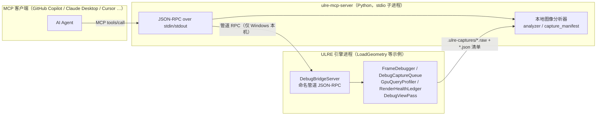

# ULRE MCP Server 对接文档

本文是 `tools/ulre-mcp-server` 的完整对接指南：架构、引擎侧启用、客户端配置、
验证步骤、全部工具参考、协议细节与故障排查。

功能契约、调试视图支持范围与图像分析语义以
[渲染自省设计文档](debug-analysis-and-view-modes.md) 和
[诊断 Skill](../.ai/skills/SKILL_RENDER_DIAGNOSTICS.md) 为准；
跨机器交接与已知限制见[渲染自省工作交接](render-introspection-handoff.md)。

---

## 1. 架构总览



三层职责：

| 层 | 位置 | 职责 |
| --- | --- | --- |
| 引擎桥接 | `src/Vulkan/DebugBridgeServer.cpp` | 在引擎进程内开命名管道 `\\.\pipe\ulre_render_debug`，把 RPC 分发到各诊断子系统 |
| MCP Server | `tools/ulre-mcp-server/mcp_server.py` | 以 stdio 子进程运行，向 MCP 客户端暴露工具；引擎类工具透传管道 RPC，图像类工具在本地分析抓帧文件 |
| MCP 客户端 | Copilot 等 | 启动并管理 MCP Server 子进程，把工具交给 AI Agent 调用 |

关键事实：

- **MCP Server 本身不需要引擎运行即可启动**；只有引擎类工具在调用时才连接管道。
  图像分析类工具（`analyze_capture` 等）完全离线，只读抓帧产物文件。
- **管道仅支持 Windows 本机**。非 Windows 上引擎类工具返回
  `{"valid": false, "error": "ULRE named pipe is available on Windows only"}`。
- **Python 侧零第三方依赖**（仅标准库 `json/math/struct/pathlib` 等），无需 `pip install`。
- 引擎桥接与 MCP 协议均使用 JSON-RPC 2.0；引擎侧解析/序列化已统一到
  nlohmann::json（经 CMUtil `JsonTool`），文本字段正确转义。

---

## 2. 前提条件

| 项 | 要求 |
| --- | --- |
| 操作系统 | Windows（引擎桥接）；图像分析工具跨平台 |
| Python | 3.8+，建议用绝对路径指定解释器（本机实测 `C:\Python314\python.exe`） |
| 引擎 | 已构建的 ULRE 示例/应用（Debug 或 Release 均可，桥接不依赖 `_DEBUG`） |
| 诊断开关 | `ULRE_DEBUG.toml` 中 `[channels] debugbridge = true` |
| 第三方包 | 无 |

---

## 3. 引擎侧启用

### 3.1 打开诊断通道

编辑仓库根目录 `ULRE_DEBUG.toml`：

```toml
[channels]
debugbridge = true   # 引擎内命名管道诊断桥接服务（显式启用）
```

- 该文件是全工程唯一的 DEBUG 通道门控输入，**只在进程启动时读取一次**，
  运行中修改无效，需重启引擎进程。
- 查找顺序：当前工作目录 → 可执行程序目录 → 由这两处逐级向上（最多 64 级）。
  因此从 `build\out\Windows_64_Debug` 直接运行 exe 也能找到仓库根目录的配置。
- 找不到文件或语法错误 ⇒ 全部通道关闭，桥接不启动，不影响正常渲染。
- 通道清单见 [debug-log-channels.md](debug-log-channels.md)。

### 3.2 桥接启动时机与管道参数

`DebugBridgeServer::StartActive()` 在 **Vulkan 设备创建完成后**自动调用
（`src/Vulkan/VKDeviceCreater.cpp`）。即：引擎进程启动且 Vulkan 初始化成功后，
管道才可用；窗口程序需正常进入渲染循环。

| 参数 | 值 | 来源 |
| --- | --- | --- |
| 管道名 | `\\.\pipe\ulre_render_debug` | `inc/hgl/vk/DebugBridgeServer.h` 默认构造参数 |
| 类型 | 双工、消息型（`PIPE_TYPE_MESSAGE`）、 overlapped | `CreateNamedPipeA` |
| 实例数 | **1**（同一时刻只有一个引擎进程能持有该管道名） | 同上 |
| 请求上限 | 4095 字节（超出返回 `-32600 Request too large`） | 服务端读缓冲 4096−1；MCP 侧同限 |
| 响应上限 | MCP 侧累计读取上限 1 MiB | `MAX_PIPE_RESPONSE_BYTES` |
| 读请求超时 | 5 秒（连接后等待请求） | `TransferPipe` |
| 抓帧排队超时 | 30 秒（排队请求过期置 `failed`） | `DebugCaptureQueue` |

MCP 侧连接管道时有 **2 秒重试窗口**（容忍 `ERROR_FILE_NOT_FOUND`/`ERROR_PIPE_BUSY`，
即 winerror 2/231），覆盖引擎刚好在重建管道实例的间隙。

### 3.3 抓帧产物

抓取文件写入**引擎进程当前工作目录**下的 `.ulre-captures/`：

```
.ulre-captures/capture_<时间戳>_<request_id>_<attachment>.raw    # 像素/字节数据
.ulre-captures/capture_<时间戳>_<request_id>_<attachment>.json   # 版本化清单（metadata）
```

分析工具一律 **metadata-first**：把 `get_capture_status` 返回的 `metadata_path`
传给 `analyze_capture`/`compare_captures`，格式、row pitch、色彩空间、帧/相机上下文
从清单读取，不要手工猜。该目录是临时产物，**不要提交进仓库**（建议加入 `.gitignore`）。

---

## 4. 客户端配置

### 4.1 GitHub Copilot 桌面应用（本机已验证）

编辑 `%USERPROFILE%\.copilot\mcp-config.json`（本机为
`C:\Users\hyzbo\.copilot\mcp-config.json`）：

```json
{
  "mcpServers": {
    "ulre-render": {
      "tools": ["*"],
      "type": "local",
      "command": "C:\\Python314\\python.exe",
      "args": [
        "-B",
        "E:\\ULRE\\tools\\ulre-mcp-server\\mcp_server.py"
      ]
    }
  }
}
```

要点：

- `command` 用 **Python 解释器绝对路径**，避免 PATH 中没有 `python` 或命中商店别名。
- `-B` 禁止写 `__pycache__`，保持工具目录干净。
- 脚本路径用绝对路径；Windows 路径大小写不敏感，但请统一使用仓库实际目录名
  `tools\ulre-mcp-server`（小写 `tools`）。
- `tools: ["*"]` 暴露全部工具；也可改为白名单数组按需收敛。
- 修改配置后**重启 Copilot 会话**使 MCP Server 重新加载。
- 在 Copilot 应用中这些工具可能以**延迟加载（deferred）**形式出现：Agent 需要先经
  工具搜索加载定义再调用，属正常行为，不是配置错误。
- 也可在应用内 Customize > Installed（全局）或项目设置 > Repository customizations >
  MCP servers（仓库级）管理该服务器。

### 4.2 仓库级配置（Copilot coding agent / CLI 项目范围）

在仓库根目录放 `.mcp.json`（或 `.github/mcp.json`），随仓库分发给其他协作者：

```json
{
  "mcpServers": {
    "ulre-render": {
      "type": "local",
      "command": "python",
      "args": ["-B", "tools/ulre-mcp-server/mcp_server.py"],
      "tools": ["*"]
    }
  }
}
```

相对路径以仓库根为基准；`python` 需在 PATH 中可用，否则同样改绝对路径。
注意：云端 coding agent 运行环境没有本机引擎进程与命名管道，引擎类工具不可用，
只有离线图像分析工具有意义。

### 4.3 其它 MCP 客户端（Claude Desktop / Cursor / VS Code 等）

通用 stdio 形式（Claude Desktop `claude_desktop_config.json`、Cursor `mcp.json`）：

```json
{
  "mcpServers": {
    "ulre-render": {
      "command": "C:\\Python314\\python.exe",
      "args": ["-B", "E:\\ULRE\\tools\\ulre-mcp-server\\mcp_server.py"]
    }
  }
}
```

VS Code 的 `.vscode/mcp.json` 使用 `servers` 键与 `type: "stdio"`：

```json
{
  "servers": {
    "ulre-render": {
      "type": "stdio",
      "command": "C:\\Python314\\python.exe",
      "args": ["-B", "E:\\ULRE\\tools\\ulre-mcp-server\\mcp_server.py"]
    }
  }
}
```

各客户端配置键名略有差异，以客户端自身文档为准；服务器本体是同一个
stdio 进程，无网络端口、无鉴权配置。

---

## 5. 验证步骤

### 5.1 离线自检（不需要引擎）

```powershell
# 分析器自检（合成 8x8 图像，覆盖亮度/法线/表面/深度/反投影/帧差）
python -B E:\ULRE\tools\ulre-mcp-server\selftest.py

# 全部 Python 单元测试（需要引擎/夹具的集成用例会跳过，跳过不等于通过）
python -B -m unittest discover -s E:\ULRE\tools\ulre-mcp-server -p "test_*.py"
```

### 5.2 MCP 协议握手（不需要引擎）

向服务器 stdin 写入一行 JSON-RPC 即可验证协议层：

```powershell
'{"jsonrpc":"2.0","id":1,"method":"initialize","params":{}}' |
    C:\Python314\python.exe -B E:\ULRE\tools\ulre-mcp-server\mcp_server.py
```

预期输出（单行）：

```json
{"jsonrpc": "2.0", "id": 1, "result": {"protocolVersion": "2024-11-05", "capabilities": {"tools": {}}, "serverInfo": {"name": "ulre-mcp-server", "version": "1.0.0"}}}
```

`tools/list` 同法可列出全部 27 个工具定义。

### 5.3 引擎端到端（需要引擎运行）

1. 确认 `ULRE_DEBUG.toml` 的 `debugbridge = true`，启动引擎示例，例如：

   ```powershell
   Start-Process E:\ULRE\build\out\Windows_64_Debug\LoadGeometry.exe -WorkingDirectory E:\ULRE
   ```

2. 在 Copilot 中让 Agent 依次调用（以下为工具名与参数对象，不是原始管道报文）：

   | 步骤 | 调用 | 预期 |
   | --- | --- | --- |
   | 1 | `list_capture_targets({})` | `valid:true`，含 `kind:"swapchain"` 的 `target_id` |
   | 2 | `get_pass_metrics({})` | `valid:true`，`frame_id` 递增，`passes` 含 `gpu_time_ms` |
   | 3 | `inspect_render_pipeline({})` | `funnel`/`cache_state`/`drops` 三段齐全 |
   | 4 | `audit_cache_invariants({})` | `status:"PASS"`（或列出具体异常规则） |
   | 5 | `capture_frame({"target_id":1,"attachment":"color"})` | 返回 `request_id`，`state:"queued"` |
   | 6 | `get_capture_status({"request_id":<id>})` | 轮询至 `succeeded`，得到 `width/height/bytes/dump_path/metadata_path` |
   | 7 | `analyze_capture({"metadata_path":<清单路径>,"operation":"luminance"})` | 离线亮度统计 |
   | 8 | `release_capture({"request_id":<id>})` | `valid:true`，释放状态槽（文件保留） |

   本分支重构后已按此序列实测通过（含 Windows 路径反斜杠在 JSON 中的正确转义）。

3. 引擎侧 C++ 回归（构建后）：

   ```powershell
   ctest --test-dir E:\ULRE\build -C Debug -R "DebugBridge|FrameDebugger|DebugView" --output-on-failure
   ```

---

## 6. 工具参考（共 27 个）

所有工具返回 `content[0].text` 为 JSON 字符串；当结果 `valid == false` 时
MCP 层标记 `isError: true`。参数表中 **粗体** 为必填。

### 6.1 引擎状态类（透传管道 RPC）

| 工具 | 参数 | 说明 |
| --- | --- | --- |
| `get_render_health` | 无 | 渲染健康账本。**空告警不代表场景健康**（生产告警生产者尚未补齐，见交接文档） |
| `get_pass_metrics` | 无 | 最近一帧 GPU 时间戳：`frame_id`、`gpu_total_time_ms`、`passes[]`（名称粗分 swapchain/offscreen，每帧最多 32 个 pass） |
| `get_camera_matrices` | 无 | 最近相机快照：`vp`/`inverse_vp`/`inverse_view`/`inverse_projection`（16 元素列主序数组）、`znear`/`zfar`、`use_reversed_z`（**数值 0/1，不是布尔**）。是最新快照，不一定是某次抓帧的相机 |
| `inspect_camera_viewport` | 无 | 相机/viewport 契约违规告警 |
| `inspect_render_pipeline` | 无 | 管线漏斗 `funnel`（scene_primitives→passed_can_render→collected_items→batched_items→batch_count→gpu_draw_count）、`cache_state`（fast-path/拓扑版本号）、`drops`（分类计数+至多 16 条样本） |
| `trace_entity_render_state` | **name**（实体名或整数字符串 ID） | 实体归因：命中丢弃样本返回 `status:"Dropped"` 及 stage/reason/detail；否则 `status:"RenderedOrPassed"`。引擎方法名为 `trace_entity_pipeline` |
| `audit_cache_invariants` | 无 | **MCP 侧计算**：读取 `inspect_render_pipeline` 后检查 4 条不变量（fast-path 期间挂起资源、拓扑版本失配、steady 门控与 resource_pending 矛盾、收集数小于通过数），返回 `PASS/FAIL` 与异常列表 |
| `dump_render_target` | name（可选，当前不按名选择） | 只读**最近一次** C++ 侧请求的 RT 抓取摘要；**不发起新抓取** |
| `dump_buffer` | name（可选，同上） | 只读最近一次 SSBO/UBO 抓取摘要；不发起新抓取 |

### 6.2 调试视图类

| 工具 | 参数 | 说明 |
| --- | --- | --- |
| `set_debug_view` | **mode**：`off`/`world_normal`/`shading_normal`/`base_color`/`surface`/`emissive`/`uv0`/`world_position` | 请求独立离屏属性视图。`world_normal` 是插值顶点法线；`shading_normal` 含法线贴图/TBN；`world_position` 为按需 RGBA32F。不支持 dither/混合/自定义材质路径，失败显式报错 |
| `get_debug_view` | 无 | 轮询直到 `mode` 等于请求值且 `target_id` 非零；`error` 表示 pass 未成功。进程级状态只反映最近处理的世界 |

调试视图开启期间每帧复用附件前等待设备空闲：**适合查 BUG，不适合性能基准**。
用完 `set_debug_view({"mode":"off"})` 关闭。

### 6.3 抓帧与缓冲类

| 工具 | 参数 | 说明 |
| --- | --- | --- |
| `list_capture_targets` | 无 | 列出交换链/普通离屏/调试视图目标及可抓取附件。普通离屏需资源所有者 opt-in，否则 `availability:"unavailable"` |
| `capture_frame` | **target_id**（≥1）、**attachment**：`color`/`depth`/`color_depth` | 排队抓取，返回 `request_id`。`color_depth` 保证两附件同帧。排队 30 秒过期 |
| `get_capture_status` | **request_id**（≥1） | 查询状态：`queued`/`succeeded`/`failed`/`cancelled`；成功时含 `width/height/format/bytes/row_pitch/pixel_size/dump_path/metadata_path`；`color_depth` 结果在 `captures` 中给出成对清单 |
| `cancel_capture` | **request_id** | 取消排队请求；进行中的读回不可取消 |
| `release_capture` | **request_id** | 释放终态状态槽；**不删除文件** |
| `list_capture_buffers` | 无 | 列出显式登记的 GPU storage buffer 及读回能力。当前生产 SSBO 仅 `GPUCullSystem.DrawCount`（其序号是派发序号，不是主帧 ID） |
| `capture_buffer` | **resource_id**（≥1）、**offset**（≥0）、**size**（4…4194304） | 有界、对齐的 buffer 区间读回 |

### 6.4 图像分析类（本地离线，读清单或 raw 文件）

| 工具 | 参数 | 说明 |
| --- | --- | --- |
| `analyze_capture` | **metadata_path**、**operation**：`luminance`/`depth`/`world_position`/`world_position_rt`/`position_crosscheck`/`normals`/`surface`；可选 `color_space_override`、`reversed_z_override`、`sample_step`（默认 16）、`allow_unverified_depth_producers`（默认 false）、`mask_metadata_path`、`depth_metadata_path` | **首选入口**。格式/色彩空间/相机上下文来自清单；`position_crosscheck` 需成对深度清单；无掩码反投影需显式 opt-in |
| `compare_captures` | **metadata_path_a**、**metadata_path_b**；可选 `threshold`（默认 0.01）、`heatmap_dir`（默认 `.ulre-analysis`）、`color_space_override`、`allow_unverified_context`（默认 false） | RGB MAE/RMSE/PSNR、8×8 SSIM、4 连通变化区域；掩码交集上计算，覆盖变化单独报告。**不校验场景/设备身份**，opt-in 不等同基线判定 |
| `analyze_shadow_semantics` | **metadata_path**；可选 `is_shadow_map_depth`（默认 false） | 区分 shadow-map 投射物覆盖与屏幕受影；后者目前 unavailable |
| `analyze_luminance` | **path**、**width**、**height**、**color_space**；可选 `pixel_format`（默认 rgba8）、`row_pitch`、`mask_alpha` | 旧式 raw 接口：亮度/曝光/死像素/NaN |
| `analyze_normals` | **path**、**width**、**height**；可选 `pixel_format`、`row_pitch`、`mask_alpha` | 旧式 raw 接口：法线长度误差/零法线/Z 分布 |
| `analyze_surface` | **path**、**width**、**height**；可选同上 | 旧式 raw 接口：roughness/metallic/AO 分布 |
| `analyze_depth` | **path**、**width**、**height**；可选 `reversed_z`、`clear_depth`、`row_pitch` | 深度分布与无效深度像素 |
| `reconstruct_world_pos` | **path**、**width**、**height**、**inverse_vp**（16 元素）；可选 `sample_step`、`row_pitch`、`clear_depth`、`reversed_z`、`viewport` | 旧式 raw 深度反投影；**绝不隐式使用最新相机**，需手工提供匹配的 inverse VP |
| `compare_frames` | **path_a**、**path_b**、**width**、**height**；可选 `pixel_format`、`threshold`、`row_pitch_a/b`、`mask_alpha`、`peak_value` | 旧式 raw 帧差；优先用 `compare_captures` |

`pixel_format` 枚举：`rgba8`/`bgra8`/`rgb8`/`a2bgr10`/`rgb10a2`/`a2r10g10b10`/`r32f`（仅亮度）/`rgba32f`。
分析器限制：单图 64 MiB、2,097,152 像素；连通区域分析上限 262,144 像素。

### 6.5 工具 → 引擎 RPC 映射

MCP 工具名默认原样作为管道 `method` 透传，两个例外：

| MCP 工具 | 管道 method | 备注 |
| --- | --- | --- |
| `trace_entity_render_state` | `trace_entity_pipeline` | 引擎侧两名等价 |
| `audit_cache_invariants` | `inspect_render_pipeline` | 不变量判定在 MCP 侧计算 |

引擎桥接另外接受 `get_pipeline_inspection`、`set_offscreen_debug_view`、
`get_offscreen_debug_view`、`list_capture_buffers` 等别名/方法，但 MCP 未全部暴露；
直接走管道调试时可用（见 §7）。

---

## 7. 协议细节

### 7.1 MCP 层（客户端 ↔ Python 服务器）

- 传输：stdio，**逐行** JSON-RPC 2.0（每请求/响应一行，`\n` 结尾）。
- `initialize` 返回 `protocolVersion: "2024-11-05"`、`serverInfo: ulre-mcp-server 1.0.0`。
- 支持方法：`initialize`、`notifications/initialized`（无响应）、`tools/list`、
  `tools/call`、`ping`；其余返回 `-32601 Method not found`。
- `tools/call` 结果：`content[0].text` 为结果 JSON 字符串；`valid:false` ⇒ `isError:true`。
  未知工具名返回 `isError:true` 的文本错误。

### 7.2 管道层（Python 服务器 ↔ 引擎）

请求信封（MCP 侧固定 `id:1`）：

```json
{"jsonrpc":"2.0","id":1,"method":"capture_frame","params":{"target_id":1,"attachment":"color"}}
```

引擎响应：

```json
{"jsonrpc":"2.0","id":1,"result":{"valid":true,"request_id":1,"state":"queued", "...":"..."}}
```

- 引擎校验：`jsonrpc=="2.0"`、`method` 必填纯字符串、`id` 必填（字符串/数字/null）、
  `params` 必须是对象、无符号整数字段拒绝负数/浮点、容器深度 ≤32、拒绝重复键与内嵌 NUL。
- 错误码：`-32600`（非法请求/超大请求）、`-32601`（未知方法）。
  MCP 侧把 RPC error 包装为 `{"valid":false,"error":"ULRE bridge RPC error","detail":{...}}`。
- 响应键按字母序序列化（nlohmann 默认行为）；客户端应按 JSON 解析，不要依赖键序。
- 手工管道调试可用任意能打开 `\\.\pipe\ulre_render_debug` 的客户端；
  一次连接处理一个请求，随后服务端断开重建实例。

### 7.3 相机/深度契约（分析工具依赖）

Vulkan RH、世界 Z-up、NDC 深度 ZO `[0,1]`；默认正高度 viewport 下 `m00>0`、`m11<0`。
矩阵列主序。反投影公式与掩码规则见诊断 Skill；**不要混入 OpenGL 深度约定**。

---

## 8. 故障排查

| 症状 | 原因与处理 |
| --- | --- |
| `ULRE bridge unavailable`（detail 含 winerror 2/231） | 引擎未运行；`debugbridge` 未开或启动后改的 toml（需重启）；Vulkan 设备尚未创建；另一引擎进程持有管道（单实例）。MCP 已含 2 秒重试，仍失败按此清单排查 |
| `ULRE named pipe is available on Windows only` | 非 Windows 平台，引擎类工具不可用；图像分析工具仍可用 |
| `ULRE bridge request exceeds the size limit` / `-32600 Request too large` | 请求超过 4095 字节；减小参数（如实体名长度） |
| `Invalid ULRE bridge response ID` | 管道对端异常/陈旧进程；关闭多余引擎进程后重试 |
| `Incomplete or oversized ULRE bridge response` | 响应超 1 MiB 或中途断开；减少单次请求的数据量（如缩小 `capture_buffer` 的 size） |
| Copilot 中看不到工具 | 检查 `mcp-config.json` 的 JSON 语法与解释器/脚本绝对路径；重启会话；延迟加载工具需 Agent 先搜索加载，属正常 |
| 启动 MCP 报找不到 python | `command` 改解释器绝对路径 |
| `inspect_render_pipeline` 返回 `valid:false` | 引擎还没有完成过收集帧；等待渲染循环跑起来 |
| `get_capture_status` 一直 `queued` 后变 `failed` | 目标未再提交（窗口最小化/暂停渲染）或 30 秒排队过期；恢复渲染后重新 `capture_frame` |
| 抓帧 `bytes:0` | 失败或不可用的抓取，**不是合法黑帧**；读 `error` 字段 |
| 引擎日志 `CreateNamedPipe failed` | 管道名被占用（另一引擎进程）或权限问题 |
| 分析结果 `NOT_COVERED` | 基线工具未覆盖该场景/设备；不是通过，按契约显式 create/update |

---

## 9. 安全与边界

- 管道使用默认安全属性，**本机任何进程均可连接**，无鉴权；不要试图把管道暴露到网络。
- 抓帧文件包含完整 framebuffer 内容，可能含敏感画面；`.ulre-captures/`、
  `.ulre-analysis/` 属临时产物，勿提交仓库。
- Debug View 与抓帧会引入设备等待/读回开销，**不可用于性能基准**；
  性能测量请走 `get_pass_metrics` 的低干扰时间戳。
- `get_render_health` 空账本、`compare_captures` 的 opt-in 比较、
  shadow-map 非清屏比例都有明确语义边界，详见设计文档与 Skill，勿过度解读。

---

## 10. 相关文档与代码入口

| 资料 | 路径 |
| --- | --- |
| 功能契约与调试视图设计 | `doc/debug-analysis-and-view-modes.md` |
| 诊断工作流 Skill | `.ai/skills/SKILL_RENDER_DIAGNOSTICS.md` |
| 交接与已知限制 | `doc/render-introspection-handoff.md` |
| 诊断通道清单 | `doc/debug-log-channels.md` |
| MCP Server 本体 | `tools/ulre-mcp-server/mcp_server.py` |
| 图像分析器 | `tools/ulre-mcp-server/analyzer.py`、`capture_manifest.py` |
| 固定场景回归 CLI | `tools/ulre-mcp-server/render_regression.py`（create/compare/update） |
| 引擎桥接 | `src/Vulkan/DebugBridgeServer.cpp`、`DebugBridgeProtocol.h`、`DebugBridgeJson.h` |
| 抓帧队列 | `src/Vulkan/DebugCaptureQueue.cpp`、`inc/hgl/vk/DebugCaptureQueue.h` |
| 帧调试器 | `src/Vulkan/FrameDebugger.cpp`、`inc/hgl/vk/FrameDebugger.h` |
| C++ 回归测试 | `src/ecs/tests/TestDebugBridgeLifecycle.cpp`、`TestFrameDebugger.cpp`、`TestDebugViewLifecycle.cpp` |
